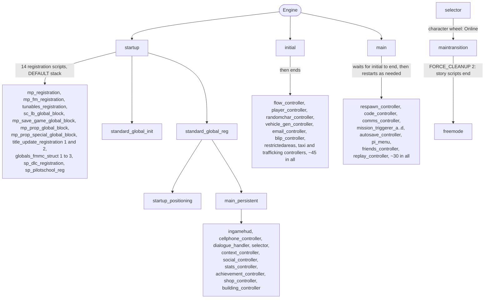

# Runtime scripts: the scripts that keep the game running

Most of GTA V's game logic runs as compiled scripts on Rockstar's script VM. A few dozen of them run all the time or start the others: they boot the game, start story mode, restart controllers that stop, hand over to GTA Online and keep the HUD, phone and shops alive. This guide gives each of them a card and draws the first pass of the launch graph (who starts whom, on which stack). Roadmap topics **R0.2** (script cards) and **R0.5** (launch graph, first pass) in the [roadmap](/ROADMAP.md).

**How it was made.** Everything marked **Verified** was read from the build-3725 decompile (the pinned commit listed in `MAP.md`, byte-identical to the test install's `script_rel.rpf`), from the script headers dumped with `tools/ysc-dump.ps1`, and from `common\data\gameconfig.xml` in `update\update.rpf` (vanilla) and `Mods\update\update.rpf` (ours). The launch graph comes from the new `tools/script-launch-graph.ps1`. **Known** marks general community knowledge still to check. No Rockstar code is quoted: only script names, native names, counts and values.

**Size** below is the number of lines in the decompiled source. Like the catalog's sizes, it is a rough weight only: many scripts compile in the same large shared headers (the clothing tables alone add about 1,700 calls to every script that includes them).

## 1.1 Short version

- **Three roots.** The engine starts `startup` at boot. `main` and `initial` have no script parent anywhere in the decompile, so the engine starts them as well (**Verified** that no script starts them by name; that the engine does is **Known**). `freemode` is started by `maintransition` through a name lookup.
- **Boot order:** `startup` loads 14 registration scripts and `standard_global_init`, then `standard_global_reg`, which starts `main_persistent`. `main_persistent` starts the ten scripts that run in both story mode and Online (HUD, phone, dialogue, character wheel, shops, stats ...). `initial` sets up a new or loaded story game, starts about 45 long-lived story controllers including `flow_controller`, and ends. `main` waits for `initial` to finish, then runs forever (**Verified**).
- **`main` is a watchdog.** Every frame it checks about 30 story controllers and restarts any that should run but doesn't. Killing a story script from a mod does not stick: `main` starts it again on the next frame unless its conditions say no (**Verified**).
- **Story and Online split on two flags.** Scripts that survive into Online call `NETWORK_SET_SCRIPT_IS_SAFE_FOR_NETWORK_GAME`. Story-only scripts check `HAS_FORCE_CLEANUP_OCCURRED` with bit 2 set, and `maintransition` calls `FORCE_CLEANUP(2)` on the way into Online, so they all clean up and end at once (**Verified**).
- **Script stacks are pooled, and some pools have one slot.** `gameconfig.xml` defines 32 stack sizes with 223 stacks in all. Story missions use the `MISSION` stack (64,500), which has **one** slot: that is what limits story mode to one mission at a time, and why director mode and the Online planning boards wait for it. `freemode` (35,250) and `maintransition` (8,032) each have one slot too (**Verified**).
- **Global memory comes in 18 blocks**, each owned by one registration script (block 0 `standard_global_init`, block 1 tunables, block 9 the Online save, 18 to 20 the mission structures ...). This is a first map for roadmap topic R0.4 (**Verified**).

## 1.2 Boot: from launch to control

Step by step (**Verified** unless marked):

1. **`startup`** marks itself safe for network games, removes two prologue IPLs, then requests 14 registration scripts and starts them one by one, each on a `DEFAULT` stack (1,424). The table that names them holds one bare hash, which resolves to `globals_fmmcstruct3_registration`. `sp_dlc_registration` waits for `title_update_registration_2`, and `sp_pilotschool_reg` waits for `sp_dlc_registration`.
2. `startup` then starts **`standard_global_init`** (it registers the 146 script brains described in [core guide 1](/docs/gameplay/missions/story-script-catalog.md#13-how-these-scripts-get-started) and sets default values in global block 0), waits a frame, and starts **`standard_global_reg`**.
3. `startup` waits until the story registration scripts have set their ready bits, then registers the save data it owns: the story save version (`fSaveVersion`, set to 1.7 in this build) and the Online save block `g_savedMPGlobals` (5,575 values, global block 9). It fills 61 tunnel and car-park interiors into a global table, starts a commerce data fetch, and ends.
4. **`standard_global_reg`** registers the story save layout (about 1,430 save-registration calls into the story save globals), restores player state, starts **`startup_positioning`** (on the `SHOP` stack, 2,324) when the player needs placing, and finally starts **`main_persistent`** and enables script brain set 1, unless the game is running the benchmark.
5. **`main_persistent`** requests ten scripts, waits until all are loaded, and starts them: `cellphone_controller`, `dialogue_handler`, `selector`, `context_controller`, `stats_controller`, `achievement_controller`, `building_controller` (all `DEFAULT`), `social_controller` (1,828), `shop_controller` (its own 3,800 pool) and `InGameHud` (5,050). It also starts `drunk_controller`, `error_listener` and the two UGC registration scripts when needed. Then it runs its own loop forever.
6. **`initial`** runs for a new or loaded story game: it sets up the three characters and the world state, starts the long-lived story controllers and ends. Which heist and prep controllers it starts depends on story progress.
7. **`main`** waits until no `initial` thread is running, sets up, and enters its loop: every frame it runs about 25 checks, every second five more and every five seconds four more.

From launch to control, the scripts that end are `startup`, the registration scripts, `standard_global_init`, `standard_global_reg`, `startup_positioning` and `initial`. The ones that stay are `main`, `main_persistent` and everything they start.

## 1.3 Rules every runtime script follows

### Watchdog launching

`main` doesn't start its controllers once. For each one it has a check that runs every frame: if the script should run (the player is alive, not on a mission, story mode active ...) and `GET_NUMBER_OF_THREADS_RUNNING_THE_SCRIPT_WITH_THIS_HASH` is 0, it requests and starts it; if the script should not run, it marks it as no longer needed. Examples (**Verified**):

- `respawn_controller` is started **only** when the player is injured or being arrested and no player switch is in progress. It isn't running the rest of the time.
- Only **one** of `mission_triggerer_a` to `d` runs. `main` picks it from story progress: a set of story flags (still to name in R5.1) moves the game from triggerer A to B, C and D.
- `director_mode` is started on the `MISSION` stack after a screen fade, with the player made invincible and frozen while it loads.

`initial`, by contrast, starts its scripts once and marks them no longer needed, so those are not restarted if they end.

### Story or Online: two flags

| Flag | Meaning | Who uses it |
| --- | --- | --- |
| `NETWORK_SET_SCRIPT_IS_SAFE_FOR_NETWORK_GAME` | The script keeps running when a network game starts | `startup`, `standard_global_reg`, `main_persistent` and everything it starts, `initial`, `maintransition`, `spawn_activities`, `error_listener` |
| `HAS_FORCE_CLEANUP_OCCURRED(mask)` with bit 2 | The script cleans up and ends when story mode hands over to Online | `main`, `flow_controller`, `respawn_controller`, `code_controller`, `player_controller`, `comms_controller`, the mission triggerers, `vehicle_gen_controller`, `blip_controller`, `email_controller`, `autosave_controller` ... |

**Verified:** every story-only controller in the cards below tests a mask that includes bit 2, none of the network-safe ones do, and `maintransition` is the script that calls `FORCE_CLEANUP(2)`. Other bits appear too: bit 8 is raised by `main`, `mission_repeat_controller`, the mission triggerers and `vehicle_gen_controller` (**Verified**), and the community names it the replay or "repeat play" cleanup (**Known**). The second pass below lists every bit.

### Every force-cleanup bit (second pass)

*Second pass (2026-10-25).* Every `FORCE_CLEANUP`, `FORCE_CLEANUP_FOR_ALL_THREADS_WITH_THIS_NAME` and `FORCE_CLEANUP_FOR_THREAD_WITH_THIS_ID` call, every `HAS_FORCE_CLEANUP_OCCURRED` mask and every `GET_CAUSE_OF_MOST_RECENT_FORCE_CLEANUP` comparison in the decompile (commit `6c18d3e8b`) was counted with `git grep`. Who raises a bit and when is **Verified**; the name given to each bit is read from those situations.

| Bit | Raised by (scripts) | When | Checked by |
| ---: | --- | --- | --- |
| 1 | `main`; also aimed at one script by name (`am_prostitute`, `controller_ambientarea` end `pb_prostitute` and other ambient threads this way) | `main` raises it when the replay system asks scripts to clean up (`REPLAY_SYSTEM_HAS_REQUESTED_A_SCRIPT_CLEANUP`, the Rockstar Editor opening from story mode), after raising 8 and 64, and then reports `SET_SCRIPTS_HAVE_CLEANED_UP_FOR_REPLAY_SYSTEM` | Most story scripts (masks 3, 11, 19, 67, 83 ... all include it) |
| 2 | `maintransition` (2 calls), `selector`, `main_persistent`; also aimed at named threads | Story mode handing over to Online | Every story-only controller |
| 4 | No script | | 3 scripts test it alone |
| 8 | 146 calls of `FORCE_CLEANUP(8)`, almost all inside one shared routine copied into each script | Before a mission replay or a world reset: `mission_repeat_controller` and `benchmark` raise 8 and 64 together, and so does `main` before the editor | Launchers, ambient controllers, shops (masks with 8) |
| 16 | No script (raised by the engine) | | The object brains (`ob_bong`, `ob_drinking_shots`, `ob_franklin_wine`, `ob_wheatgrass`, `ob_mp_bed_low`, `ob_mp_shower_med`) and `pickupvehicles` |
| 32 | No script (raised by the engine) | | The always-running story trackers: `achievement_controller`, `stats_controller`, `social_controller`, `drunk_controller`, `ingamehud`, `timershud`, and `flow_controller` (mask 34) |
| 64 | `main`, `mission_repeat_controller`, `benchmark` | Always together with 8 (mission replay, benchmark, editor) | `shop_controller`, `taxiservice`, `vehicle_gen_controller`, the `family_scene_*` scripts (they keep a prop in hand unless the cause is 64) |
| 128 | `director_mode` | Entering director mode, once the player is ready | Masks such as 146 and 210 |

Bits 16 and 32 are never raised by a script, so the engine raises them; what for is open (an in-game test can watch `GET_CAUSE_OF_MOST_RECENT_FORCE_CLEANUP` in a small script). Of the 1,000-odd `HAS_FORCE_CLEANUP_OCCURRED` tests, the commonest masks are 3 (bits 1 and 2, 138 tests), 19 (1, 2, 16; 92), 11 (1, 2, 8; 43), 83 (1, 2, 16, 64; 42) and 2 (32). For a mod: test the same mask as the story scripts you live next to; mask 3 ends with them on the way to Online and into the editor.

### Stacks come from fixed pools

Every `START_NEW_SCRIPT` call passes a stack size, and the engine takes the stack from a pool of that exact size defined in `gameconfig.xml` (`ConfigScriptStackSizes`). When a pool is empty, the start fails, which is why `selector` loops on `GET_NUMBER_OF_FREE_STACKS_OF_THIS_SIZE(8032)` before it starts `MainTransition`. Table in [1.4](#14-script-stack-pools).

### Globals are owned, not shared freely

Global variables live in blocks of 262,144 (2^18) slots. Global `N` is in block `N >> 18`. Each block is created by the one script whose header declares it, which is the whole job of the registration scripts: most of them contain almost no code, only the block's initial data. Table in [1.5](#15-global-blocks).

## 1.4 Script stack pools

From `common\data\gameconfig.xml`. **Verified:** the vanilla file and the one in our `Mods\update\update.rpf` (which raises other pool sizes) have identical stack tables. "Used by" comes from the launch graph.

| Pool | Size | Stacks | Used by (examples) |
| --- | --- | --- | --- |
| `MICRO` | 128 | 20 | The UGC registration scripts, `flow_help`, `buildingsiteambience`, `pickupvehicles` |
| `MINI` | 512 | 20 | `emergencycall`, `gb_biker_target_rival` |
| `DEFAULT` | 1,424 | 68 | Most controllers and registration scripts (102 scripts in the graph) |
| `SPECIAL_ABILITY` | 1,828 | 13 | `social_controller`, `vehicle_gen_controller`, `mission_stat_watcher` |
| `FRIEND` | 2,050 | 12 | `friends_controller`, `mission_repeat_controller`, `net_cloud_mission_loader`, heist controllers |
| `SHOP` / `IE_DELIVERY` | 2,324 | 6 / 1 | `startup_positioning`, shop scripts |
| `SMPL_INTERIOR` | 2,512 | 1 | Simple interiors |
| `CELLPHONE` | 2,600 | 2 | Phone apps |
| `PAUSE_MENU_SCRIPT` | 3,076 | 2 | Pause menu scripts |
| `VEHICLE_SPAWN` | 3,568 | 1 | |
| `CAR_MOD_SHOP` | 3,750 | 2 | Mod shops |
| `SHOP_CONTROLLER` | 3,800 | 1 | `shop_controller` |
| `CONTACTS_APP` | 4,000 | 1 | `appcontacts` |
| `DEBUG_SCRIPT`, `SOAK_TEST`, `DEBUG_MENU` | 4,080, 4,088, 35,000 | 1 each | Debug tools (empty in release) |
| `NETWORK_BOT` | 4,096 | 31 | Network test bots |
| `APP_INTERNET` | 4,592 | 1 | `appinternet`, `appsecuroserv`, `appbikerbusiness`, `appimportexport` |
| `INGAMEHUD` | 4,600 | 1 | Unused by name: `InGameHud` is started with 5,050 |
| `AM_MP_YACHT` | 5,000 | 3 | `am_mp_yacht` |
| `MULTIPLAYER_MISSION` | 5,050 | 19 | `InGameHud`, the mission triggerers, `pi_menu`, `animal_controller`, many Online scripts (46 in the graph) |
| `TRANSITION` | 8,032 | 1 | `MainTransition` |
| `SCRIPT_XML` | 8,344 | 4 | `sctv`, arcade cabinet games |
| `INTERACTION_MENU` | 9,800 | 1 | `am_pi_menu` |
| `WAREHOUSE` | 14,100 | 1 | `freemode_clearglobals` |
| `ACTIVITY_CREATOR_INT` | 15,900 | 3 | `am_mp_island`, `missioniaaturret`, casino and nightclub peds |
| `PROPERTY_INT` | 19,400 | 1 | Property interiors |
| `FMMC_LAUNCHER` | 28,000 | 1 | `fmmc_launcher`, the Creator |
| `MP_LAUNCH_SCRIPT` | 35,250 | 1 | `freemode` |
| `MISSION` | 64,500 | 1 | Every story and stranger mission, `director_mode`, the Online planning boards, the content creators, `traffick_air` |
| `MULTIPLAYER_FREEMODE` | 89,500 | 1 | `fm_mission_controller`, `fm_deathmatch_controler`, `fm_survival_controller` |

**Verified:** `flow_controller` starts story missions by hash on 64,500, and each `launcher_*` for a stranger mission starts the mission on 64,500 plus `mission_stat_watcher` on 1,828.

**Known:** ScriptHookV, ScriptHookVDotNet and Lua mods do **not** use these pools. They run as their own fibers on the game's main thread (roadmap R1.1). They only touch the pools when they start Rockstar scripts themselves.

## 1.5 Global blocks

From the script headers (`tools/ysc-dump.ps1`, field `globalblock`). Exactly 18 of the 1,143 scripts declare globals. **Verified.**

| Block | First global | Globals | Owner script | Started by | What it holds |
| --- | --- | --- | --- | --- | --- |
| 0 | `Global_0` | 153,879 | `standard_global_init` | `startup` | Story mode and shared state, including the story save globals (`Global_114904` onward, registered for saving by `standard_global_reg`) |
| 1 | `Global_262144` | 37,437 | `tunables_registration` | `startup` | Tunables. `Global_262145` is the most-read global in the game: 31,290 reads in `freemode` alone |
| 2 | `Global_524288` | 27,051 | `profiler_registration` | No script by name or hash | Unused: the script is empty and no script reads or writes any global in the block (second pass) |
| 3 | `Global_786432` | 228,707 | `ugc_global_registration` | `main_persistent`, `maintransition`, `ingamehud`, the creators | UGC (user-generated content) data |
| 4 | `Global_1048576` | 11,047 | `ugc_global_registration_2` | as block 3 | More UGC data |
| 5 | `Global_1310720` | 261,487 | `mp_prop_global_block` | `startup` | Online properties |
| 6 | `Global_1572864` | 119,044 | `mp_registration` | `startup` | Online core state |
| 7 | `Global_1835008` | 154,200 | `mp_fm_registration` | `startup` | Freemode state |
| 8 | `Global_2097152` | 6,224 | `sc_lb_global_block` | `startup` | Social Club leaderboards |
| 9 | `Global_2359296` | 5,575 | `mp_save_game_global_block` | `startup` | The Online save (`g_savedMPGlobals`, registered for saving by `startup`) |
| 10 | `Global_2621440` | 120,582 | `title_update_registration` | `startup` | Title update additions |
| 11 | `Global_2883584` | 537 | `sp_dlc_registration` | `startup` | Story-mode DLC save data |
| 12 | `Global_3145728` | 1 | `sp_pilotschool_reg` | `startup` | Story Pilot School save flag |
| 13 to 15 | | | none | | Unused |
| 16 | `Global_4194304` | 88,652 | `mp_prop_special_global_block` | `startup` | Special properties (has real code: position tables) |
| 17 | `Global_4456448` | 120,090 | `title_update_registration_2` | `startup` | Later title update additions |
| 18 | `Global_4718592` | 232,541 | `globals_fmmc_struct_registration` | `startup` | The mission (FMMC) structures |
| 19 | `Global_4980736` | 220,559 | `globals_fmmcstruct2_registration` | `startup` | More mission structures |
| 20 | `Global_5242880` | 33,170 | `globals_fmmcstruct3_registration` | `startup` | More mission structures |

"What it holds" is read from the script names and from which scripts read each block (**Known** in detail; mapping the contents is R0.4).

## 1.6 Script cards

Each card: what starts it and on which stack, whether it survives into Online, its loop, what it starts, and what it is for. All **Verified** unless marked.

### Boot and registration

**`startup`** (13,526 lines). Started by the engine. Network-safe. No loop: runs once and ends. Starts the 14 registration scripts, `standard_global_init` and `standard_global_reg` (all `DEFAULT`). Owns the save registration of the Online save block and the story save version; fills the tunnel interior table; triggers the commerce (store) data fetch. Detects the benchmark and auto-multiplayer launches (`LOBBY_AUTO_MULTIPLAYER_FREEMODE` and others) and commits the loading screen choice.

**`standard_global_init`** (4,377 lines). Started by `startup`. Owns global block 0. Sets default values and registers the 146 script brains (99 world-point brains, 47 object brains). Ends at once.

**`standard_global_reg`** (108,777 lines). Started by `startup`. Network-safe, no loop. Registers the story save layout (about 1,430 save-registration calls), sets up the player ped, toggles the `BLIMP` scenario group from the save, starts `startup_positioning` (2,324) when needed and `main_persistent` (1,424), then enables script brain set 1.

**`startup_positioning`** (130,372 lines). Started by `standard_global_reg`. Places the player and character at the start position after a load. Ends.

**The registration scripts** (`mp_registration`, `mp_fm_registration`, `tunables_registration`, `sc_lb_global_block`, `mp_save_game_global_block`, `mp_prop_global_block`, `mp_prop_special_global_block`, `title_update_registration` and `_2`, `globals_fmmc_struct_registration`, `globals_fmmcstruct2_registration`, `globals_fmmcstruct3_registration`, `sp_dlc_registration`, `sp_pilotschool_reg`). Started by `startup`. Each owns one global block (table in 1.5). Most are 4 to 230 lines; the two story ones also register one save value each and set a ready bit that `startup` waits on.

### Always running (story and Online)

**`main_persistent`** (432,443 lines). Started by `standard_global_reg`. Network-safe, runs forever. Starts the ten shared scripts listed in [1.2](#12-boot-from-launch-to-control), plus `drunk_controller`, `error_listener` and the UGC registrations. Creates the three family relationship groups (`RELGROUPHASH_FAMILY_M`, `_F`, `_T`), suppresses invites at start and handles confirmed ones, and runs a long list of shared per-frame checks with a 60-second timer for slower work. The globals it reads most are in blocks 7, 10 and 18 (freemode state, title update data, mission structures), so much of its work is Online support.

**`selector`** (108,607 lines). Started by `main_persistent`. Network-safe. The character wheel and player switching; also the way into Online: it requests `MainTransition`, waits up to 20 seconds for it to load, waits for a free `TRANSITION` stack and starts it, then stays active until the transition ends.

**`InGameHud`** (121,219 lines). Started by `main_persistent` and again by `maintransition`, on 5,050. Network-safe. HUD logic and the activity feed (91 `ACTIVITY_FEED_*` posts).

**`cellphone_controller`** (7,785 lines). Started by `main_persistent`. Network-safe. Phone state and theme; starts `cellphone_flashhand` (the phone in the hand). D-pad Up opens it, which clashes with menu mods that also use D-pad Up (R6.4).

**`dialogue_handler`** (5,185 lines). Started by `main_persistent`. Network-safe. Runs scripted conversations and phone calls (conversation files, speaker lookup, stopping conversations).

**`context_controller`** (1,253 lines). Started by `main_persistent`. Network-safe. Starts the Online computer apps on `APP_INTERNET` (4,592): `appSecuroServ`, `appBikerBusiness`, `appImportExport`, `appInternet`.

**`social_controller`** (53,297 lines, 1,828). Network-safe. Social Club presence and app data blocks.

**`stats_controller`** (3,652 lines). Network-safe. Periodic stat bookkeeping using network time.

**`achievement_controller`** (17,700 lines). Network-safe. Awards achievements from stats and profile settings.

**`building_controller`** (11,724 lines). Network-safe. Swaps world states by IPL (273 `IS_IPL_ACTIVE` checks, 180 removals, 121 requests) and sets doors: the before and after states of buildings changed by the story and Online. Central to R4.5.

**`shop_controller`** (450,585 lines, its own 3,800 stack). Network-safe. Runs every shop: clothes, barbers, tattoos, guns, mod shops (2,289 `DISABLE_CONTROL_ACTION` calls: shops lock most controls). Central to R5.7 and R6.3.

**`drunk_controller`** (854 lines). Network-safe. The drunk camera effect (timecycle, motion blur, camera shake).

**`error_listener`** (219 lines). Network-safe. Watches script events and bails out of the network session (`NETWORK_BAIL`) when it receives an error event.

### Story mode

**`main`** (174,289 lines). Started by the engine (**Known**; no script starts it). Not network-safe; ends on force cleanup bit 2. The watchdog described in [1.3](#watchdog-launching). Starts or restarts: `respawn_controller`, `code_controller`, `comms_controller`, `mission_triggerer_a` to `d` (5,050, one at a time), `mission_repeat_controller` (2,050), `autosave_controller`, `save_anywhere`, `replay_controller`, `director_mode` (64,500), `pi_menu` (5,050), `player_controller_b` (5,050), `friends_controller` (2,050), `randomchar_controller`, `animal_controller` (5,050), `controller_races`, `country_race_controller`, `controller_towing`, `cablecar`, the photography and ambient scripts (`ambient_ufos`, `ambient_sonar`, `ambient_solomon`, `ambientblimp`), `bootycallhandler`, `flow_help` (128) and `net_cloud_mission_loader` (2,050). It also reactivates launcher world brains that are waiting to go out of range.

**`initial`** (99,684 lines). Started by the engine for a new or loaded story game (**Known**). Network-safe, no loop. Sets up the characters, then starts: `flow_controller`, `player_controller`, `randomchar_controller`, `vehicle_gen_controller` (1,828), `email_controller`, `event_controller`, `emergencycalllauncher`, `taxiLauncher`, `restrictedAreas`, `pickup_controller`, `controller_AmbientArea`, `blip_controller`, `candidate_controller`, `cheat_controller`, `completionpercentage_controller`, `stock_controller`, `mission_stat_alerter`, `controller_taxi`, `controller_trafficking`, `letterscraps`, the heist controllers (`heist_ctrl_agency`, `_docks`, `_finale`, `_jewel`, `_rural`, 2,050) and other story-state scripts. Ends.

**`flow_controller`** (140,279 lines). Started by `initial`. Ends on force cleanup (bits 2 and 32). The story mission flow; starts each story mission by hash on the `MISSION` stack and `mission_stat_watcher` (1,828) next to it. Topic R5.1.

**`mission_triggerer_a` to `d`** (about 112,000 lines each). Started by `main`, one at a time by story progress. Place the mission triggers in the world. Call `FORCE_CLEANUP(8)`.

**`respawn_controller`** (99,154 lines). Started by `main` only on death or arrest. Hospital and police-station respawns (R6.2).

**`code_controller`** (61,608 lines). Started by `main`. The story's delayed-action scheduler: 235 timed slots kept in the story save globals; when a slot's time passes it runs that action (door states, stats, savehouse changes, conversations, help text).

**`player_controller`** (112,143 lines) and **`player_controller_b`** (5,050). Player character state: outfits, tattoos and character-specific behaviour (to read in detail in R6.1).

**`comms_controller`** (13,840 lines). Story phone calls and their queue (texts to check in R5.7). **`email_controller`** (7,028 lines). Story emails.

**`randomchar_controller`** (6,388 lines). Strangers and freaks availability: opens doors and watches the launchers (R5.4).

**`vehicle_gen_controller`** (37,590 lines). Story vehicle generators and the characters' saved vehicles and garages (R4.3).

**`blip_controller`** (2,799 lines). Story-mode blips (priority, colour, short range).

**`autosave_controller`** (93,637 lines). Autosave (R5.3).

**`mission_repeat_controller`** (2,050). Mission replay from the pause menu; starts `mission_stat_watcher`, `controller_taxi`, `ambient_tonya` and `buildingsiteambience` around a replay.

### Online

**`maintransition`** (376,686 lines, 8,032). Started by `selector`. Network-safe. The move from story mode to Online and back: calls `FORCE_CLEANUP(2)`, restarts `InGameHud`, starts `spawn_activities`, `fm_maintain_cloud_header_data` and the UGC registrations, then starts **`freemode`** on the `MP_LAUNCH_SCRIPT` stack (35,250), or the Creator on 28,000. It goes back to story mode with `SHUTDOWN_AND_LAUNCH_SINGLE_PLAYER_GAME`, which runs the boot again; `SHUTDOWN_AND_LOAD_MOST_RECENT_SAVE` is its kick-and-restart path ([guide 3](/docs/00-getting-started/boot.md#35-launching-into-online)). Topic R7.2.

**`freemode`** (1,470,129 lines; 7.9 MB of bytecode, the largest script). Started by `maintransition`. A network script (it doesn't use the network-safe flag; it *is* the network game). Starts by name: `fmmc_launcher` (28,000), `am_pi_menu` (9,800), `am_mp_yacht` (5,000), `am_mp_island` and `missioniaaturret` (15,900), `freemode_clearglobals` (14,100), `sctv` (8,344), the four laptop apps (4,592), `spawn_activities`, `net_cloud_mission_loader`, `emergencycalllauncher`, `vehicle_stealth_mode`, `fake_interiors` and more through lookup tables. Topic R7.1.

**`spawn_activities`** (104,862 lines). Network-safe. Started by `maintransition`, `freemode` and the deathmatch and public mission controllers. What the player is doing when they spawn (sleeping, smoking, in a property).

## 1.7 The launch graph, first pass (R0.5)

`tools/script-launch-graph.ps1` reads the decompile with `git grep` at the pinned commit and finds every launch whose script name is written in the call: direct `START_NEW_SCRIPT*` calls and wrapper calls of the form `func_N("name", stack)`, `func_N(joaat("name"), stack)` or `func_N(hash, stack)`, resolving hashes with joaat against the 1,147 script names. It takes under a minute.

**Result (Verified):** 679 launch edges from 283 calling scripts to 230 started scripts. The full table is [`reference/Script-Launch-Graph.md`](/scripting/script-launch-graph.md). The scripts started from the most places are `buddydeathresponse` (96 callers, nearly every story mission), `cellphone_flashhand` (55), `am_mp_drone` (33), `mission_stat_watcher` (23) and `am_mp_peds` (21).

**What it misses:** launches where the name comes from a variable or a lookup table, such as `startup`'s registration table (added by hand above), `freemode`'s table-driven launches, `flow_controller`'s missions, the world-point and object script brains (listed in core guide 1), and the engine's own starts. The second pass resolves the lookup functions that return a script name, and draws the story and Online graphs as diagrams.

## 1.8 What this means for modders

- **Don't fight `main` by killing scripts.** A story controller terminated by a mod is restarted by `main` on the next frame when its conditions hold. To stop story systems for a custom Online mode, either change the condition `main` checks (for example a story flag), or use the same route Rockstar uses: force cleanup bit 2 ends every story controller at once. Whether bit 2 is safe to raise without a real transition still needs an in-game test (R5.7).
- **One mission at a time is a stack limit.** Before starting any Rockstar script on the `MISSION` (64,500), `MP_LAUNCH_SCRIPT` (35,250), `MULTIPLAYER_FREEMODE` (89,500) or `TRANSITION` (8,032) stack, check `GET_NUMBER_OF_FREE_STACKS_OF_THIS_SIZE`: each pool has one slot and the start fails silently when it's taken. A story mission, director mode or a planning board already holds `MISSION`.
- **Raising stack counts** is possible in `gameconfig.xml` (the same file the pool mods edit). SHVDN and ScriptHookV mods don't use these pools at all.
- **Read globals, never write them** (R11.5). The block table in 1.5 tells you which block an address belongs to and which script owns it, so an update-check tool (R11.2) can warn when a block's size changes in a new build.
- **`InGameHud`, the phone, `selector` and `shop_controller` keep running in Online.** An offline Online mode can rely on them being there, and must not start second copies.
- **The boot order is the order to hook in.** A mod that needs story globals ready should wait until `initial` has ended (as `main` does); one that needs the Online globals should wait for `freemode` to run.

## 1.9 Open questions

Answered in the second pass: the force-cleanup bits ([every force-cleanup bit](#every-force-cleanup-bit-second-pass)) and `profiler_registration` (empty, and global block 2 is never used). Still open: what the engine raises bits 16 and 32 for.

| Question | Where it goes |
| --- | --- |
| What exactly the engine does to start `main`, `initial` and `startup`, and in which order | R1.2 |
| The story flags that pick the active mission triggerer | R5.1 |
| Resolve table-driven launches (second pass of the graph) | Mostly answered in [launches by variable and by table](/scripting/script-launch-graph.md#launches-by-variable-and-by-table-second-pass): 220 calls followed back, ten tables read; `freemode`'s launches by request left |
| What the engine raises force-cleanup bits 16 and 32 for (no script raises them) | In-game test: log `GET_CAUSE_OF_MOST_RECENT_FORCE_CLEANUP` |
