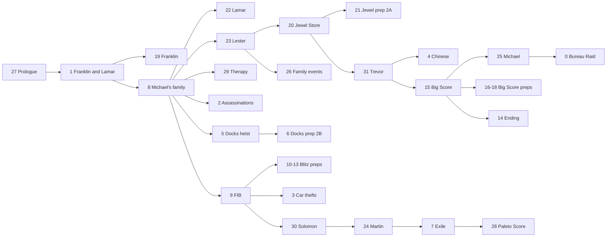

# The story mission flow: how missions unlock

How GTA V decides which story mission is available next: the mission table, the flow program built by `initial` and run by `flow_controller`, the 32 strands and how they unlock each other, the flow flags, and where all of it is kept in the save. Roadmap topic **R5.1** in the [roadmap](/ROADMAP.md). The scripts named here have cards in [engine guide 1](/docs/core/runtime-scripts.md).

**How it was made.** Read from the build-3725 decompile (`standard_global_init`, `initial`, `flow_controller`, `main`, the mission triggerers). The strand contents and the unlock links were extracted by following the order of the flow-building calls in `initial`, which makes them **Verified** as data; where a strand jumps between labels the order can differ by one mission, so the dependency list in 2.6 is an accurate first reading rather than a play-tested map. **Known** marks general knowledge. Command and field names in *italics* are ours: Rockstar's names are compiled out (commands are identified by hashes).

## 2.1 Short version

- **A mission table** of 94 story missions is built at boot by `standard_global_init`: script name, short code (`PRO1`, `ARM1` ...), the blip it uses, which characters can start it, a time-of-day window, option flags, and the list of its medal stats.
- **The story is a program.** `initial` writes 1,882 *flow commands* into one array (room for 1,900), split into **32 strands**: one per storyline (Franklin and Lamar, the FIB, the Docks heist, Trevor, Solomon, the therapy sessions ...). Each strand runs its commands in order: show a mission, wait for it, set a flag, unlock another strand, wait for a flag another strand sets.
- **`flow_controller` runs the program**, two strands per frame in turn. A command either waits (try again next frame), moves on, or jumps to a label. The program counter of every strand is in the story save, so the story picks up where it was.
- **Strands unlock each other in two ways:** a strand can *activate* another strand (30 links: `prologue1` activates the Franklin and Lamar strand), or wait for a *flow flag* that another strand sets after a mission (57 flags: `michael4` can't unlock until `franklin2` and `solomon3` are done).
- **`main` runs one mission triggerer at a time**, chosen by progress: A until `trevor1` is done, B until `fbi4`, C until `michael1`, then D. The triggerers put the mission blips and trigger scenes in the world.
- **The story ends** when all 32 strands reach their end command; the save then marks the flow complete, and `main` stops running triggerers.

## 2.2 The mission table

`standard_global_init` fills a table of 94 entries, 34 values each, kept in global block 0 (`Global_93192`). **Verified** layout:

| Field | What it holds | Example (`prologue1`) | How we know |
| --- | --- | --- | --- |
| 0 to 5 | Script name (text) | `prologue1` | Copied as a string |
| 6 | Hash of the script name | | `GET_HASH_KEY` of the name; used to start it |
| 7 | Index of the mission's data in the flow program | | Written by the mission command builders in `initial` |
| 8 to 9 | Short code | `PRO1` | Used in stats and text labels |
| 10 | Blip id | 263 | Mission blips are numbered in story order (heist missions 217 to 242 in sequence); `263` is tested specially |
| 11 | Characters who can trigger it, one bit each (Michael 1, Franklin 2, Trevor 4) | 5 | Tested against the current character |
| 12 | Character mask with more bits (values up to 53) | 5 | Read into character lists; meaning of the upper bits to check |
| 13, 14 | Time window in game hours, start and end, `-1` for any time | `-1`, `-1` | Compared with `GET_CLOCK_HOURS`. Night jobs run 19 to 6, `trevor2` 0 to 2, `finaleA` 22 to 23, `rural_bank_setup` 7 to 17 |
| 15 | Option flags (31 bits) | 917,513 | Read in 306 scripts; bit 30 switches the time window off |
| 16, 17 | Number of medal stats and their ids | | Filled by `main`: up to a dozen stat ids per mission, from 0 to 738 |

The 94 missions include the assassinations (`Assassin_Valet` and others), the therapy sessions (`drf1` to `drf5`), Michael's family events (`me_amanda1`, `me_jimmy1`, `me_tracey1`), every heist setup, prep and finale, and the endings (`finaleA`, `finaleB`, `finaleC1`, `finaleC2`, `finale_credits`).

## 2.3 Where the flow lives in the save

All of it is in the story save block (`Global_114904`, see [engine guide 3](/docs/00-getting-started/boot.md)), in one structure at `f_9092` (**Verified**):

| Part | What it holds |
| --- | --- |
| `f_9092` | Set once the flow has started |
| `f_9092.f_1` | **Flow complete**: set when every strand has ended |
| `f_9092.f_2[0..31]` | One slot per strand: state bits (bit 1 active, bit 2 finished) and the strand's **program counter** |
| `f_9092.f_99[0..56]` | The 57 **flow flags** (set by one strand, waited for by another) |
| `f_9092.f_99.f_58[...]` | Flow integers (28 different indexes used directly, up to 137) |
| `f_9092.f_99.f_205[...]` | A small third array (up to index 12) |
| `f_9092.f_330[mission]` | Six values per mission; the first is **mission completed** |

The commands themselves are not saved: `initial` rebuilds the program on every boot (into `Global_80551`), and only the program counters, flags and completion are kept. That is why a new build of the game can change a strand without breaking old saves, as long as the command order before each saved position stays the same.

## 2.4 The flow program

**Building it (Verified).** For each strand, `initial` calls an "open strand" function, then a sequence of command builders, then "close strand". Each builder appends one command (a type hash, a data pool, an index into that pool) to an array of at most 1,900 commands, and stores its arguments in the data pool for its type. Opening and closing a strand records the range of commands that belongs to it. All 32 strands together hold 1,882 commands.

**Running it (Verified).** `flow_controller` loops forever. Each frame, unless an autosave is in progress or the flow is paused (for example during a replay), it takes the next two strands in turn and, for each active strand that isn't finished, runs the command at its program counter. A command handler returns:

| Return | Meaning |
| --- | --- |
| `-1` | Not done yet: stay on this command, try again next frame |
| `-2` | Done: move to the next command |
| a command index | Jump there (to a label) |

When all 32 strands have finished, it sets *flow complete* in the save.

**The command vocabulary.** 69 command types exist (71 builder functions); the ones we have identified (**Verified** from their handlers or arguments):

| Our name | Uses in the strands | What it does |
| --- | --- | --- |
| *Strand start* | 32 | First command of every strand |
| *Strand end* | 32 | Sets the strand's finished bit |
| *Label* | 154 | A jump target; does nothing when reached |
| *Debug marker* | 99 | Does nothing in the release build (one of its two builders even drops its argument); likely a development aid. Jumps come from the return values of other commands, such as the mission commands |
| *Mission with trigger* | 82 | Runs a story mission that the player starts at its blip. Arguments: mission id, where to go on a pass (`-2` = next command), and a label, which is the one placed just before the mission, so our reading is "on a fail, offer it again" |
| *Mission, straight away* | 11 | The same for missions that start without a trigger: `prologue1`, `armenian1`, `fbi3`, `jewelry_heist`, `finaleC2`, `finale_credits`, two therapy sessions and Michael's three family events |
| *Set flow flag* | 58 | Sets one of the 57 flags |
| *Wait for flow flag* | 57 | Waits until a flag is set |
| *Activate strand* | 30 | Switches another strand on |
| *Launch script* | 25 | Starts a helper script by name with a stack size (`ambient_Solomon`, `heist_ctrl_rural` ...) |
| *Weapon command* | 36 | Takes a weapon hash and a flag (`weapon_remotesniper` in the Solomon strand); probably unlocks it in shops (our reading) |

The busiest command, used 223 times, and about 40 other types still need their handlers read: they set blips, phone contacts, emails and texts, savehouses, shop and vehicle unlocks, and the character state between missions (**Known** from the game; mapping each one is the next pass of this topic).

## 2.5 The 32 strands

Strand numbers are the save slots. "Unlocks" lists the strands it activates and after which mission (**Verified**).

| # | Storyline | Missions in order | Unlocks |
| --- | --- | --- | --- |
| 0 | The Bureau Raid | `agency_heist1`, `agency_prep1`, `agency_heist3A`, `agency_heist3B` | |
| 1 | Franklin and Lamar (Simeon) | `armenian1`, `armenian2`, `armenian3` | 19 after `armenian2`; 8 after `armenian3` |
| 2 | Lester's assassinations | `Assassin_Valet`, `_Multi`, `_Hooker`, `_Bus`, `_Construction` | |
| 3 | Devin Weston's car thefts | `carsteal1` to `carsteal4` | |
| 4 | The Chinese (Trevor) | `chinese1`, `chinese2` | |
| 5 | The Merryweather (Docks) heist | `docks_setup`, `docks_prep1`, `docks_heistA`, `docks_heistB` | 6 after `docks_setup` |
| 6 | Docks prep 2B | `docks_prep2B` | |
| 7 | Exile | `exile1` to `exile3` | 28 after `exile1` |
| 8 | Michael's family | `family1`, `family3`, `family2`, `family4`, `family5`, `family6` | 22 after `family1`; 23 and 29 after `family3`; 2, 5 and 9 after `family4` |
| 9 | The FIB | `fbi1`, `fbi2`, `fbi3`, `fbi4_intro`, `fbi4_prep1`, `fbi4`, `fbi5A` | 10, 12, 13 after `fbi4_intro`; 3 and 30 after `fbi4` |
| 10 to 13 | Blitz Play preps 2 to 5 | one prep each | |
| 14 | The ending | `finale_intro`, `finaleA`, `finaleB`, `finaleC1`, `finaleC2`, `finale_credits` | |
| 15 | The Big Score | `finale_heist1`, `finale_heist2_intro`, `finale_heist_prepA`, `finale_heist2A`, `finale_heist_prepB`, `finale_heist2B` | 25 after `finale_heist1`; 16 after `finale_heist2_intro`; 14 after `finale_heist2B` |
| 16 to 18 | Big Score preps C and D | `finale_heist_prepC` (three variants), `finale_heist_prepD` | 16 activates 17 and 18 |
| 19 | Franklin | `franklin0`, `franklin1`, `franklin2` | |
| 20 | The Jewel Store Job | `jewelry_setup1`, `jewelry_prep1A`, `jewelry_prep1B`, `jewelry_heist` | 21 after `jewelry_setup1`; 31 after `jewelry_heist` |
| 21 | Jewel prep 2A | `jewelry_prep2A` | |
| 22 | Lamar | `lamar1` | |
| 23 | Lester | `lester1` | 20 and 26 after `lester1` |
| 24 | Martin Madrazo | `martin1` | 7 after `martin1` |
| 25 | Michael | `michael1` to `michael4` | 0 after `michael2` |
| 26 | Michael's family events | `me_amanda1`, `me_tracey1`, `me_jimmy1` | |
| 27 | Prologue | `prologue1` | 1 after `prologue1` |
| 28 | The Paleto Score | `rural_bank_setup`, `rural_bank_prep1`, `rural_bank_heist` | |
| 29 | Dr Friedlander (therapy) | `drf1` to `drf5` | |
| 30 | Solomon Richards | `solomon1` to `solomon3` | 24 after `solomon1` |
| 31 | Trevor | `trevor1` to `trevor4` | 4 after `trevor1`; 15 after `trevor4` |

93 of the 94 missions are run by a strand. The one that isn't is `agency_heist2` (table id 67), which the Bureau Raid strand reaches some other way (to check in R5.2).

Every strand except 11 (Blitz prep 3) and 27 (Prologue) is activated by another strand. The prologue strand is switched on when a new game starts, and Blitz prep 3 some other way (both to check in R5.2).

## 2.6 Mission prerequisites (the flow flags)

A strand waits for a flag before its next mission; another strand sets the flag after one of its missions. Read each line as "B can't become available until A is done" (**Verified** from the command order; see the caveat at the top):

| Mission (B) | Needs (A) |
| --- | --- |
| `Assassin_Hooker` | `carsteal1` |
| `Assassin_Construction` | `exile1` |
| `carsteal3` | `martin1` |
| `carsteal4` | `michael1` |
| `chinese2` | `trevor2` |
| `docks_heistA` | `docks_prep2B`, `fbi3` |
| `drf2`, `drf3`, `drf4` | `family4`, `solomon1`, `exile1` |
| `drf5` | `family6`, `michael3`, `solomon3` |
| `exile2`, `exile3` | `rural_bank_setup`, `rural_bank_heist` |
| `family2` | `franklin0` |
| `family4`, `family5`, `family6` | `trevor3`, `fbi1`, `agency_heist1` |
| `fbi4_intro` | `docks_prep1` |
| `fbi4` | `Assassin_Valet`, `docks_heistB`, `family5`, `franklin1`, Blitz preps 2, 4 and 5 |
| `fbi5A` | `exile3` |
| `finale_heist1` | `solomon1` |
| `finale_heist2_intro` | `michael4` |
| `finale_heist2A` / `2B` | the Big Score preps C and D |
| `franklin1` | `fbi2`, `lamar1` |
| `franklin2` | `family6`, `michael3` |
| `jewelry_prep1A` | `family2` |
| `jewelry_prep1B` | `jewelry_prep2A` |
| `lamar1` | `franklin0` |
| `martin1` | `carsteal2` |
| `me_tracey1`, `me_jimmy1` | `family6`, `michael4` |
| `michael1` | `carsteal3` |
| `michael2` | `carsteal4` |
| `michael3` | `agency_heist3B` |
| `michael4` | `franklin2`, `solomon3` |
| `rural_bank_heist` | `exile2` |
| `solomon2` | `michael2` |
| `solomon3` | `agency_heist1`, `family6` |
| `trevor3` | `chinese2` |
| `trevor4` | `fbi5A` |

Some flags are set at the very start of a strand (for example the Franklin strand releases `family1`, and the Chinese strand releases `trevor2`), which only means "once that strand is active".

## 2.7 The mission triggerers

`main` keeps exactly one of `mission_triggerer_a` to `d` running while the player is alive, not being arrested, story mode is active, no mission is running and the flow isn't complete (**Verified**, [engine guide 1](/docs/core/runtime-scripts.md#watchdog-launching)):

| Triggerer | Runs while |
| --- | --- |
| A | `trevor1` not yet passed |
| B | `trevor1` passed, `fbi4` not yet |
| C | `fbi4` passed, `michael1` not yet |
| D | `michael1` passed |

Each triggerer covers the missions of its part of the story: it places the blip, checks the trigger conditions (character, time window from the mission table, wanted level) and builds the trigger scene. Each one raises force cleanup bit 8 when a mission takes over ([engine guide 2](/scripting/script-vm.md#26-force-cleanup)). What exactly each triggerer contains is part of R5.2.

## 2.8 What this means for modders

- **The story can be read and changed as data.** The strand table and the prerequisite list above say exactly what unlocks what, so a mod can tell the player why a mission isn't available, or show a story map.
- **Reading progress is safe; writing it is not.** The flags, program counters and completion values are in the save. Reading them (for example "has `michael4` been passed?" from `f_9092.f_330`) is how a mod should check story progress. Writing them would desync the flow from the world state the commands set up (blips, contacts, unlocks), so mods must not (rule R11.5).
- **A mod's own progression system** can copy the design: a list of strands, each a sequence of steps; steps that wait, move on or jump; flags that link strands; only the positions and flags saved, the program rebuilt on every start. That keeps saves compatible across the mod's updates.
- **An offline Online mode** doesn't need any of this running: force cleanup bit 2 stops `flow_controller` and the triggerers (engine guide 1), and the flow state stays in the story save untouched.

## 2.9 Open questions

| Question | Where it goes |
| --- | --- |
| The remaining 40-odd command types (blips, contacts, texts, unlocks, savehouses, character state) | Next pass of R5.1 |
| The meaning of mission-table field 12 above bit 4, and of the option flags in field 15 | Next pass of R5.1 |
| How `agency_heist2` and Blitz prep 3 are reached | R5.2 |
| The pass and fail labels of each mission command: what happens on a fail | R5.2 (the mission side is in [guide 3](/docs/gameplay/missions/mission-anatomy.md#37-failing); the flow side is still open) |
| What the flow integers (`f_99.f_58`) hold; index 120 is read 1,434 times | R5.1, R5.3 |
| How `mission_repeat_controller` replays a mission without moving the flow | R5.2 |
