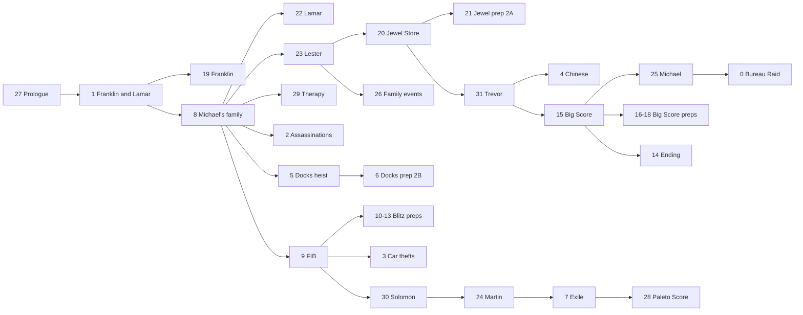

# The story mission flow: how missions unlock

How GTA V decides which story mission is available next: the mission table, the flow program built by `initial` and run by `flow_controller`, the 32 strands and how they unlock each other, the flow flags, and where all of it is kept in the save. Roadmap topic **R5.1** in the [roadmap](/ROADMAP.md). The scripts named here have cards in [engine guide 1](/docs/core/runtime-scripts.md).

**How it was made.** Read from the build-3725 decompile (`standard_global_init`, `initial`, `flow_controller`, `main`, the mission triggerers). The strand contents and the unlock links were extracted by following the order of the flow-building calls in `initial`, which makes them **Verified** as data; where a strand jumps between labels the order can differ by one mission, so the dependency list in 2.6 is an accurate first reading rather than a play-tested map. **Known** marks general knowledge. The **second pass** (sections marked so) decoded every strand command by command, read the handler of every command type in `flow_controller`, and took the names of the saved values from `standard_global_reg`. Command and field names in *italics* are ours: Rockstar's names are compiled out (commands are identified by hashes).

## 2.1 Short version

- **A mission table** of 94 story missions is built at boot by `standard_global_init`: script name, short code (`PRO1`, `ARM1` ...), the blip it uses, which characters can start it, a time-of-day window, option flags, and the list of its medal stats.
- **The story is a program.** `initial` writes 1,882 *flow commands* into one array (room for 1,900), split into **32 strands**: one per storyline (Franklin and Lamar, the FIB, the Docks heist, Trevor, Solomon, the therapy sessions ...). Each strand runs its commands in order: show a mission, wait for it, set a flag, unlock another strand, wait for a flag another strand sets.
- **`flow_controller` runs the program**, two strands per frame in turn. A command either waits (try again next frame), moves on, or jumps to a label. The program counter of every strand is in the story save, so the story picks up where it was.
- **Strands unlock each other in two ways:** a strand can *activate* another strand (30 links: `prologue1` activates the Franklin and Lamar strand), or wait for a *flow flag* that another strand sets after a mission (57 flags: `michael4` can't unlock until `franklin2` and `solomon3` are done).
- **`main` runs one mission triggerer at a time**, chosen by progress: A until `trevor1` is done, B until `fbi4`, C until `michael1`, then D. The triggerers put the mission blips and trigger scenes in the world.
- **The story ends** when all 32 strands reach their end command; the save then marks the flow complete, and `main` stops running triggerers.

## 2.2 The mission table

`standard_global_init` fills a table of 94 entries, 34 values each, kept in global block 0 (`Global_93192`). **Verified** layout:

| Field | What it holds | Example (`prologue1`) | How we know |
| --- | --- | --- | --- |
| 0 to 5 | Script name (text) | `prologue1` | Copied as a string |
| 6 | Hash of the script name | | `GET_HASH_KEY` of the name; used to start it |
| 7 | Index of the mission's data in the flow program | | Written by the mission command builders in `initial` |
| 8 to 9 | Short code | `PRO1` | Used in stats and text labels |
| 10 | Blip id | 263 | Mission blips are numbered in story order (heist missions 217 to 242 in sequence); `263` is tested specially |
| 11 | Characters who can trigger it, one bit each (Michael 1, Franklin 2, Trevor 4) | 5 | Tested against the current character |
| 12 | Characters in the mission, playable or not (values up to 53) | 5 | Bits 1, 2, 4 are the three players; bits 8, 16 and 32 are characters 19, 14 and 17, see [2.2.1](#221-the-mission-table-flags-second-pass) |
| 13, 14 | Time window in game hours, start and end, `-1` for any time | `-1`, `-1` | Compared with `GET_CLOCK_HOURS`. Night jobs run 19 to 6, `trevor2` 0 to 2, `finaleA` 22 to 23, `rural_bank_setup` 7 to 17 |
| 15 | Option flags (31 bits) | 917,513 | Read in 306 scripts; bit 30 switches the time window off; the bits we could read are in [2.2.1](#221-the-mission-table-flags-second-pass) |
| 16, 17 | Number of medal stats and their ids | | Filled by `main`: up to a dozen stat ids per mission, from 0 to 738 |

The 94 missions include the assassinations (`Assassin_Valet` and others), the therapy sessions (`drf1` to `drf5`), Michael's family events (`me_amanda1`, `me_jimmy1`, `me_tracey1`), every heist setup, prep and finale, and the endings (`finaleA`, `finaleB`, `finaleC1`, `finaleC2`, `finale_credits`).

### 2.2.1 The mission-table flags (second pass)

**Field 12** (**Verified**). `flow_controller` tests it for a character id: ids 0 to 2 use bits 1, 2 and 4 like field 11, and three more ids have their own bit: character **19** is bit 8, **14** is bit 16 and **17** is bit 32. The flow uses field 12 to write the "last mission" stat for each player character (`sp_last_mission_name`, then `sp0_`, `sp1_` or `sp2_last_mission_name` for each player bit), and the family scenes, `player_timetable_scene`, `appcontacts` and `comms_controller` use it to ask whether a mission involves a given character. Which person each id is comes from the flow's contact commands: Franklin is given contact 19 when the prologue strand opens, and Michael is given 14 and 17 after `armenian3`. Together with the missions that carry the bits, our reading is that **19 is Lamar** (bit 8 is on `armenian1`, `armenian2`, `franklin0`, `franklin1`, `franklin2`, `lamar1`, `carsteal4`), **14 is Jimmy** (bit 16 is on `me_jimmy1`, `michael4`, `family1`, `family2`, `family4` to `family6`, `armenian3`) and **17 is Amanda** (bit 32 is on `me_amanda1`, `family1`, `family3` to `family6`, `michael4`, `armenian3`).

**Field 15**, the bits whose effect we could read (**Verified** from the code that tests them; the other bits are read only inside `flow_controller`, `mission_repeat_controller` or the triggerers, and are left open):

| Bit | Tested by | Effect |
| --- | --- | --- |
| 1 | `flow_controller`, mission scripts | On a fail, follow the mission command's fail label instead of staying on the command (see [2.4.2](#242-what-a-fail-does-to-the-flow)). Set on `drf1` to `drf5`, `finale_heist2_intro` and `finale_credits` |
| 4 | `flow_controller` | Don't start `mission_stat_watcher` with the mission |
| 5 | `achievement_controller` | The mission doesn't count for the achievement checked by type 1 |
| 7 | `finale_endgame`, `flow_controller` | On a pass, don't count the mission in the missions-passed stat |
| 13, 20 | 112 scripts (bit 13) and 85 (bit 20): ambient scripts and launchers (`act_cinema`, the stranger launchers, `bailbond_launcher` ...) | Always read for the mission in progress (`Global_99326`): the ambient script asks whether the current story mission allows it. What each bit allows is left open |
| 16 | 72 mission scripts (shared replay code) | Never offer to skip the mission: without it, a skip is offered from the second failure (`missionFailsNoProgress` of 2 or more) |
| 26 | `savegame_bed` | No saving in a bed while this mission is in progress |
| 30 | `flow_controller` | Ignore the time window in fields 13 and 14 |

## 2.3 Where the flow lives in the save

All of it is in the story save block (`Global_114904`, see [engine guide 3](/docs/00-getting-started/boot.md)), in one structure at `f_9092` (**Verified**):

| Part | What it holds |
| --- | --- |
| `f_9092` | Set once the flow has started |
| `f_9092.f_1` | **Flow complete**: set when every strand has ended |
| `f_9092.f_2[0..31]` | One slot per strand: state bits (bit 1 active, bit 2 finished) and the strand's **program counter** |
| `f_9092.f_99[0..56]` | The 57 **flow flags** (set by one strand, waited for by another); Rockstar's save name is `MF_CONTROL_SYNCIDS` |
| `f_9092.f_99.f_58[0..145]` | 146 **flag IDs** (`MF_CONTROL_FLAGIDS`): true or false story-state flags that strands and mission scripts set and read, see [2.6.1](#261-the-flag-ids-second-pass) |
| `f_9092.f_99.f_205[0..12]` | 13 **int IDs** (`MF_CONTROL_INTIDS`) |
| `f_9092.f_99.f_219[...]` | **Bitset IDs** (`MF_CONTROL_BITSETIDS`) |
| `f_9092.f_330[mission]` | Six values per mission (`MF_MISSION_STRUCT_`): `completed`, `missionFailsNoProgress`, `missionFailsTotal`, `iCompletionOrder`, `iScore`, `fStatCompletion` |

The names in this table come from `standard_global_reg`, which registers the block for saving as `FLOW_STRUCT` with `isGameflowActive` and `flowCompleted` as its first two values (**Verified**, second pass). A sister block, `FLOW_CUSTOM_STRUCT` (`Global_114904.f_10023`), keeps a short list of strand overrides (`MF_STRANDS_TO_OVERRIDE_ARRAY`, `MF_COMMAND_POINTER_OVERRIDE_ARRAY`, `MF_MISSION_TO_UNCOMPLETE` ...) that two flow commands add to and remove from.

The commands themselves are not saved: `initial` rebuilds the program on every boot (into `Global_80551`), and only the program counters, flags and completion are kept. That is why a new build of the game can change a strand without breaking old saves, as long as the command order before each saved position stays the same.

## 2.4 The flow program

**Building it (Verified).** For each strand, `initial` calls an "open strand" function, then a sequence of command builders, then "close strand". Each builder appends one command (a type hash, a data pool, an index into that pool) to an array of at most 1,900 commands, and stores its arguments in the data pool for its type. Opening and closing a strand records the range of commands that belongs to it. All 32 strands together hold 1,882 commands.

**Running it (Verified).** `flow_controller` loops forever. Each frame, unless an autosave is in progress or the flow is paused (for example during a replay), it takes the next two strands in turn and, for each active strand that isn't finished, runs the command at its program counter. A command handler returns:

| Return | Meaning |
| --- | --- |
| `-1` | Not done yet: stay on this command, try again next frame |
| `-2` | Done: move to the next command |
| a command index | Jump there (to a label) |

When all 32 strands have finished, it sets *flow complete* in the save.

**The command vocabulary.** 69 command types exist (71 builder functions); the ones we have identified (**Verified** from their handlers or arguments):

| Our name | Uses in the strands | What it does |
| --- | --- | --- |
| *Strand start* | 32 | First command of every strand |
| *Strand end* | 32 | Sets the strand's finished bit |
| *Label* | 154 | A jump target; does nothing when reached |
| *Debug marker* | 99 | Does nothing in the release build (one of its two builders even drops its argument); likely a development aid. Jumps come from the return values of other commands, such as the mission commands |
| *Mission with trigger* | 82 | Runs a story mission that the player starts at its blip. Arguments: mission id, where to go on a pass (`-2` = next command), and a fail label placed earlier in the strand; what a fail does is in [2.4.2](#242-what-a-fail-does-to-the-flow) |
| *Mission, straight away* | 11 | The same for missions that start without a trigger: `prologue1`, `armenian1`, `fbi3`, `jewelry_heist`, `finaleC2`, `finale_credits`, two therapy sessions and Michael's three family events |
| *Set flow flag* | 58 | Sets one of the 57 flags |
| *Wait for flow flag* | 57 | Waits until a flag is set |
| *Activate strand* | 30 | Switches another strand on |
| *Launch script* | 25 | Starts a helper script by name with a stack size (`ambient_Solomon`, `heist_ctrl_rural` ...) |
| *Weapon command* | 36 | Takes a weapon hash and a flag (`weapon_remotesniper` in the Solomon strand); probably unlocks it in shops (our reading) |

The other types are mapped in 2.4.1.

### 2.4.1 Every command type (second pass)

**How it was mapped.** `flow_controller`'s dispatcher switches on the command's type hash (87 hashes in two switch blocks). For each hash we found the builder in `initial` that writes it, counted the calls to that builder, and read the handler, with the save sections it writes named by `standard_global_reg` (see [saves 15.4](/docs/core/saves.md#154-whats-in-the-story-save)). The counts add up to the 1,882 commands of the 32 strands. The names are ours; "what it does" is **Verified** from the handler unless it says "our reading".

| Our name | Uses | What it does (save section it writes) |
| --- | ---: | --- |
| *Set building state* | 223 | Switches a building state: IPLs and interior entity sets on or off (`BUILDING_STATES`, 198 of them). By far the busiest command: 120 uses switch one on, the rest off |
| *Label* | 154 | Jump target |
| *Cancel communication* | 124 | Takes a call, text or email out of every queue (queued, missed and chat calls, queued texts, queued emails), two builders |
| *Debug marker* | 99 | Nothing in the release build |
| *Set flag ID* | 94 | Sets a flag ID true or false (`MF_CONTROL_FLAGIDS`) |
| *Run code ID* | 88 | Arms a code-control entry with a delay (`CODE_CONTROL_RUNFLAG_ARRAY` and `_EXECUTE_TIMER_ARRAY`, 235 ids): a numbered piece of code in the flow scripts that runs once its timer is up |
| *Mission with trigger* | 82 | See 2.4 and 2.4.2 |
| *Add chat call* | 76 | Adds an optional call the player can make to a character, for an hour of game time (`COMM_CONTROL_CHAT_CALLS_ARRAY`) |
| *Queue text* | 60 | Queues a text from a character to one or more players (`COMM_CONTROL_QUEUED_TEXTS_ARRAY`); can wait until it is sent |
| *Set flow flag* / *Wait for flow flag* | 58 / 57 | The sync IDs of 2.6 |
| *Add phone contact* | 50 | Adds a character to the phone book of one player or all three, and posts the feed message (`CHARSHEET_SAVED_ARRAY`); one more builder removes a contact (1 use) |
| *If flag ID* | 46 | Jumps to one of two labels depending on a flag ID |
| *Queue call* | 40, 15, 6, 3 | Four variants that queue a call from a character (`COMM_CONTROL_QUEUED_CALLS_ARRAY`): plain, with a second speaker, with conversation options, and one that records the player's yes or no answer (`Last_Call_Response`) |
| *Queue email* | 39 | `COMM_CONTROL_QUEUED_EMAILS_ARRAY` |
| *Weapon command* | 36 | Unlocks a weapon (and reads the DLC weapon components); see 2.4 |
| *Vehicle generator* | 34 | Switches a vehicle generator on or off (`VEHICLE_GEN_SAVED_DATA_STRUCT`): the parked mission and character vehicles |
| *Friend connection* | 31, 8, 8, 6 | Four commands on `FRIENDS_SAVED_ARRAY`: make or break a friendship link between two characters (31) and three that set its state |
| *Set door state* | 31 | Locks or unlocks a door through the door system (`DOOR_STATES`) |
| *Activate strand* | 30 | See 2.5 |
| *Wait (milliseconds)* | 27 | Waits a number of milliseconds of game time |
| *Launch script* | 25 | See 2.4 |
| *Activate stranger mission* | 23 | Switches on a random-character mission (`SAVED_RANDOM_CHARACTERS`) |
| *Set character available* | 21 | Makes a player character available or not (`PP_INFO_STRUCT` `AVAILABLE`) |
| *Set savehouse* | 20 | Turns a savehouse (its respawn point and blip) on or off (`RESPAWN_LOCATION_DATA`, `SET_SAVE_HOUSE`) |
| *Queue help text* | 19 | Queues a help message (`FLOW_HELP_STRUCT`); another command clears one (7) |
| *Heist bit* | 18 | Sets or clears a bit of a heist's choice and help flags (`HEIST_DATA_STRUCT`) |
| *Flow override* | 16, 13 | Removes and adds an entry of `FLOW_CUSTOM_STRUCT` |
| *Heist planning branch* | 13 | Jumps by the choice made at a heist board (our reading: it reads the int ID of the heist and a flag ID) |
| *Mission, straight away* | 11 + 1 | See 2.4; the "+1" is a third mission builder used only by `agency_heist2` (2.5) |
| *Go to* | 11 | Unconditional jump to a label |
| *Unlock clothes* | 10 | Unlocks an outfit or clothing item for a player character in the shops |
| *If int ID* | 10 | Jumps by the value of an int ID |
| *Set character scene* | 8 | Picks the scene a player character is found in when switched to, and clears their last known position (`PLAYER_SCENE_SAVED_DATA`); another command (5) sets their priority-switch flags |
| *Wait for mission* | 8 | Waits until a given mission is completed |
| *If script check* | 6 | Calls a check function and jumps on its result |
| *If mission completed* | 5 | Jumps on a mission's `completed` value |
| *Finish strand* | 5 | Marks another strand finished (and active) without running it |
| *Character switch state* | 5 | Waits for any conversation and (optionally) a cutscene to end, then changes switch rules for a character |
| *Profile setting* | 4 + 1 | Writes the profile settings "prologue complete" and "Chop mission complete" |
| *Special ability* | 3 | Locks or unlocks a character's special ability (`SPECIAL_ABILITY`) |
| *Static blip* | 3 | Switches a static map blip |
| *Set strand position* | 2 | Moves another strand's program counter to one of its labels |
| *Set int ID*, *set bitset ID* | 2, 1 | `MF_CONTROL_INTIDS`, `MF_CONTROL_BITSETIDS` |
| Ten others, 1 or 2 uses each | 16 | Suppress a vehicle model, a shop-data change, a finance (stock) update, a vehicle purchase, a relationship-group change, a player distance check, a player-model check, a clothing check, a wait on a global, and one that makes the player invincible and clears projectiles nearby |

The other 18 hashes in the dispatcher have no builder in `initial` in this build: waits on the in-game clock and date, setting the clock, a second set of comms commands, a stranger-mission switch-off, a blip removal and a command that only sets a flag of `Global_80551`. They were used during development or by earlier builds (our reading).

### 2.4.2 What a fail does to the flow

A mission command keeps three targets: where to go on a pass (`-2` = the next command), a label for the fail, and a third value the builder copies from the pass target when it isn't given (**Verified**, `initial`). Only `finaleA` and `finaleB` give the third value, and it points at the label of the next ending; what selects it is left open. When the mission script ends, the handler in `flow_controller` checks whether it passed:

- **Pass:** it records the pass and returns the pass target.
- **Fail:** unless field 15 bit 1 is set, it restores the three characters' saved ped data (`PP_INFO_STRUCT`), resets the mission's launch state, opens the fail screen itself (replay state 0, with the skip check, [mission anatomy 3.6](/docs/gameplay/missions/mission-anatomy.md#36-checkpoints-retry-and-skip)) and **stays on the same command** (`-1`). The save counts the fail (`missionFailsNoProgress`, `missionFailsTotal`). A retry or skip relaunches the mission under the same command. If the player chooses **Exit**, `replay_controller` ends in state 11, and on its next run the command returns its fail label (second pass, **Verified**).
- **Fail with bit 1 set** (the five therapy sessions, `finale_heist2_intro`, `finale_credits`), or when a global (`Global_102465` in build 3725) marks the fail as final: it returns the fail label. Every fail label in the 82 *mission with trigger* commands sits earlier in the same strand (66 of them directly before the mission, the rest a few commands earlier), so this also offers the mission again, after re-running the commands between the label and the mission. `finale_heist2_intro` has `-2` as its fail target, so failing it moves the strand on.

The one exception is `agency_heist2` (2.5), whose fail label sits before Lester's phone call, so a failed planning mission makes Lester call again.

## 2.5 The 32 strands

Strand numbers are the save slots. "Unlocks" lists the strands it activates and after which mission (**Verified**).

| # | Storyline | Missions in order | Unlocks |
| --- | --- | --- | --- |
| 0 | The Bureau Raid | `agency_heist1`, `agency_prep1`, `agency_heist3A`, `agency_heist3B` | |
| 1 | Franklin and Lamar (Simeon) | `armenian1`, `armenian2`, `armenian3` | 19 after `armenian2`; 8 after `armenian3` |
| 2 | Lester's assassinations | `Assassin_Valet`, `_Multi`, `_Hooker`, `_Bus`, `_Construction` | |
| 3 | Devin Weston's car thefts | `carsteal1` to `carsteal4` | |
| 4 | The Chinese (Trevor) | `chinese1`, `chinese2` | |
| 5 | The Merryweather (Docks) heist | `docks_setup`, `docks_prep1`, `docks_heistA`, `docks_heistB` | 6 after `docks_setup` |
| 6 | Docks prep 2B | `docks_prep2B` | |
| 7 | Exile | `exile1` to `exile3` | 28 after `exile1` |
| 8 | Michael's family | `family1`, `family3`, `family2`, `family4`, `family5`, `family6` | 22 after `family1`; 23 and 29 after `family3`; 2, 5 and 9 after `family4` |
| 9 | The FIB | `fbi1`, `fbi2`, `fbi3`, `fbi4_intro`, `fbi4_prep1`, `fbi4`, `fbi5A` | 10, 12, 13 after `fbi4_intro`; 3 and 30 after `fbi4` |
| 10 to 13 | Blitz Play preps 2 to 5 | one prep each | |
| 14 | The ending | `finale_intro`, `finaleA`, `finaleB`, `finaleC1`, `finaleC2`, `finale_credits` | |
| 15 | The Big Score | `finale_heist1`, `finale_heist2_intro`, `finale_heist_prepA`, `finale_heist2A`, `finale_heist_prepB`, `finale_heist2B` | 25 after `finale_heist1`; 16 after `finale_heist2_intro`; 14 after `finale_heist2B` |
| 16 to 18 | Big Score preps C and D | `finale_heist_prepC` (three variants), `finale_heist_prepD` | 16 activates 17 and 18 |
| 19 | Franklin | `franklin0`, `franklin1`, `franklin2` | |
| 20 | The Jewel Store Job | `jewelry_setup1`, `jewelry_prep1A`, `jewelry_prep1B`, `jewelry_heist` | 21 after `jewelry_setup1`; 31 after `jewelry_heist` |
| 21 | Jewel prep 2A | `jewelry_prep2A` | |
| 22 | Lamar | `lamar1` | |
| 23 | Lester | `lester1` | 20 and 26 after `lester1` |
| 24 | Martin Madrazo | `martin1` | 7 after `martin1` |
| 25 | Michael | `michael1` to `michael4` | 0 after `michael2` |
| 26 | Michael's family events | `me_amanda1`, `me_tracey1`, `me_jimmy1` | |
| 27 | Prologue | `prologue1` | 1 after `prologue1` |
| 28 | The Paleto Score | `rural_bank_setup`, `rural_bank_prep1`, `rural_bank_heist` | |
| 29 | Dr Friedlander (therapy) | `drf1` to `drf5` | |
| 30 | Solomon Richards | `solomon1` to `solomon3` | 24 after `solomon1` |
| 31 | Trevor | `trevor1` to `trevor4` | 4 after `trevor1`; 15 after `trevor4` |

All 94 missions are run by a strand (**Verified**, second pass). The first pass missed `agency_heist2` (table id 67, the Bureau Raid planning at Lester's) because the Bureau Raid strand runs it with a builder of its own, used nowhere else: after `agency_heist1` the strand queues Lester's call, places a label, and starts `agency_heist2` straight away when it is reached (the handler is the same as the *mission, straight away* command's). Its fail label is the one before Lester's call, so a failed planning mission makes Lester call again.

Blitz Play prep 3 (strand 11, `fbi4_prep3`, the garbage truck) is never activated (**Verified**, second pass). Right after `fbi4_intro` the FIB strand activates strands 10, 12 and 13, launches the ambient script `FBI4_Prep3Amb` (stack 2050) and runs *finish strand* on 11, which marks it active and finished without running any of its commands. `FBI4_Prep3Amb` watches the world for the `trash` trucks and runs prep 3 from there. The strand's own last command (set sync 18) therefore never runs, and nothing waits for sync 18: `fbi4` needs preps 2, 4 and 5 only (2.6), so prep 3 is optional.

Every strand except 11 (Blitz prep 3) and 27 (Prologue) is activated by another strand. The prologue strand is switched on when a new game starts (`initial` and `standard_global_reg` set its active bit directly), and Blitz prep 3 is never activated (see above).

## 2.6 Mission prerequisites (the flow flags)

A strand waits for a flag before its next mission; another strand sets the flag after one of its missions. Read each line as "B can't become available until A is done" (**Verified** from the command order; see the caveat at the top):

| Mission (B) | Needs (A) |
| --- | --- |
| `Assassin_Hooker` | `carsteal1` |
| `Assassin_Construction` | `exile1` |
| `carsteal3` | `martin1` |
| `carsteal4` | `michael1` |
| `chinese2` | `trevor2` |
| `docks_heistA` | `docks_prep2B`, `fbi3` |
| `drf2`, `drf3`, `drf4` | `family4`, `solomon1`, `exile1` |
| `drf5` | `family6`, `michael3`, `solomon3` |
| `exile2`, `exile3` | `rural_bank_setup`, `rural_bank_heist` |
| `family2` | `franklin0` |
| `family4`, `family5`, `family6` | `trevor3`, `fbi1`, `agency_heist1` |
| `fbi4_intro` | `docks_prep1` |
| `fbi4` | `Assassin_Valet`, `docks_heistB`, `family5`, `franklin1`, Blitz preps 2, 4 and 5 |
| `fbi5A` | `exile3` |
| `finale_heist1` | `solomon1` |
| `finale_heist2_intro` | `michael4` |
| `finale_heist2A` / `2B` | the Big Score preps C and D |
| `franklin1` | `fbi2`, `lamar1` |
| `franklin2` | `family6`, `michael3` |
| `jewelry_prep1A` | `family2` |
| `jewelry_prep1B` | `jewelry_prep2A` |
| `lamar1` | `franklin0` |
| `martin1` | `carsteal2` |
| `me_tracey1`, `me_jimmy1` | `family6`, `michael4` |
| `michael1` | `carsteal3` |
| `michael2` | `carsteal4` |
| `michael3` | `agency_heist3B` |
| `michael4` | `franklin2`, `solomon3` |
| `rural_bank_heist` | `exile2` |
| `solomon2` | `michael2` |
| `solomon3` | `agency_heist1`, `family6` |
| `trevor3` | `chinese2` |
| `trevor4` | `fbi5A` |

Some flags are set at the very start of a strand (for example the Franklin strand releases `family1`, and the Chinese strand releases `trevor2`), which only means "once that strand is active".

### 2.6.1 The flag IDs (second pass)

The array the first pass called "flow integers" is Rockstar's `MF_CONTROL_FLAGIDS`: 146 true-or-false flags (index 146 is the "none" value the handlers skip). The flow sets 52 of them with *set flag ID* and branches on them with *if flag ID*; mission and ambient scripts set and read the rest directly. Across the decompile, 28 different indexes are used directly (**Verified**, counted with `git grep` over the build-3725 decompile, every read and write of `f_9092.f_99.f_58[n]`).

| Flag | References | Set by | What it means |
| ---: | ---: | --- | --- |
| 120 | 1,521, in 550 scripts | The Exile strand, as soon as it opens (after `martin1`); cleared by the FIB strand after `fbi5A` | **Michael and Trevor are in exile** (our reading from where it is set and cleared; the same strand launches `exile_city_denial`). Almost every script reads it through a shared header, which explains the count |
| 131 | 509 | The FIB strand after `fbi5A`, together with clearing 120 | The exile is over |
| 118, 119 | 410 each | 119: the Trevor strand after `trevor4`; 118: mission scripts | Read when choosing the characters' vehicles: 118 with Trevor's `bagger`, 119 switches a vehicle extra and a plate (`BETTY 32`) |
| 4 | 354 | The Jewel Store strand after `jewelry_heist` | Read together with checks that `jewelry_setup1` and `jewelry_heist` aren't running |
| 128 | 316 | The family strand after `family5` | Read with 131 when choosing character 0's car: `premier` instead of `tailgater` while 128 is set and 131 isn't |
| 121, 122, 123 | 184, 184, 150 | 123: the family strand after `family2`; 121: 75 scripts and 122: 97 scripts, mostly missions and the player scripts | `player_controller` dresses character 0 in a set outfit while 120 is set and 122 isn't, and then sets 121; scripts set 122 once 121 is set |
| 65, 66 | 236, 118 | 66: the prologue strand (set), the Franklin and Lamar strand after `armenian1` (cleared), the Solomon strand after `solomon2` (set); 65: mission scripts | Read per character: 65 for characters 0 and 2, 66 for character 1 |

What the remaining flags mean is left open; each one is named only by where it is set.

## 2.7 The mission triggerers

`main` keeps exactly one of `mission_triggerer_a` to `d` running while the player is alive, not being arrested, story mode is active, no mission is running and the flow isn't complete (**Verified**, [engine guide 1](/docs/core/runtime-scripts.md#watchdog-launching)):

| Triggerer | Runs while |
| --- | --- |
| A | `trevor1` not yet passed |
| B | `trevor1` passed, `fbi4` not yet |
| C | `fbi4` passed, `michael1` not yet |
| D | `michael1` passed |

**No separate flag picks the triggerer** (**Verified**, second pass, `main`). The choice reads only the `completed` value of three missions in `MF_MISSION_ARRAY`: table ids 62 (`trevor1`), 38 (`fbi4`) and 46 (`michael1`). Before it, `main` checks, in order: the player is alive and not being arrested; the flow isn't complete; no flow command acted this frame (`Global_80551.f_1`, set by `flow_controller` whenever a command returns anything but "not done yet"); the current mission type (`Global_44869` in build 3725) is one that allows off-mission work, which a compatibility table in `main` accepts for the values 15, 5 and 17; `benchmark` isn't running and a block bit (`Global_80529` bit 0) is clear. What each mission-type value means is a third-pass question (CORE-033).

Each triggerer covers the missions of its part of the story: it places the blip, checks the trigger conditions (character, time window from the mission table, wanted level) and builds the trigger scene. Each one raises force cleanup bit 8 when a mission takes over ([engine guide 2](/scripting/script-vm.md#26-force-cleanup)). What exactly each triggerer contains is part of R5.2.

## 2.8 What this means for modders

- **The story can be read and changed as data.** The strand table and the prerequisite list above say exactly what unlocks what, so a mod can tell the player why a mission isn't available, or show a story map.
- **Reading progress is safe; writing it is not.** The flags, program counters and completion values are in the save. Reading them (for example "has `michael4` been passed?" from `f_9092.f_330`) is how a mod should check story progress. Writing them would desync the flow from the world state the commands set up (blips, contacts, unlocks), so mods must not (rule R11.5).
- **A mod's own progression system** can copy the design: a list of strands, each a sequence of steps; steps that wait, move on or jump; flags that link strands; only the positions and flags saved, the program rebuilt on every start. That keeps saves compatible across the mod's updates.
- **An offline Online mode** doesn't need any of this running: force cleanup bit 2 stops `flow_controller` and the triggerers (engine guide 1), and the flow state stays in the story save untouched.

## 2.9 Open questions

| Question | Where it goes |
| --- | --- |
| The remaining 40-odd command types (blips, contacts, texts, unlocks, savehouses, character state) | Answered in [2.4.1](#241-every-command-type-second-pass) |
| The meaning of mission-table field 12 above bit 4, and of the option flags in field 15 | Partly answered in [2.2.1](#221-the-mission-table-flags-second-pass): field 12 answered; field 15 bits 1, 4, 5, 7, 16, 26 and 30 named, the rest third pass |
| How `agency_heist2` and Blitz prep 3 are reached | Answered in [2.5](#25-the-32-strands) |
| The pass and fail labels of each mission command: what happens on a fail | Mostly answered in [2.4.2](#242-what-a-fail-does-to-the-flow); what selects the third target of `finaleA` and `finaleB` is third pass |
| What the flow integers (`f_99.f_58`) hold; index 120 is read 1,434 times | Partly answered in [2.6.1](#261-the-flag-ids-second-pass): they are 146 flag IDs; flag 120 is the exile, ten more are placed; the rest third pass |
| The story flags that pick the active mission triggerer (CORE-020) | Answered in [2.7](#27-the-mission-triggerers): none, only three missions' `completed` values |
| What the values of the current mission type (`Global_44869` in build 3725) mean, and the compatibility table in `main` that lets the triggerers run for 15, 5 and 17 | Third pass (CORE-033) |
| How `mission_repeat_controller` replays a mission without moving the flow | Answered in [mission anatomy 3.9](/docs/gameplay/missions/mission-anatomy.md#39-passing) |
