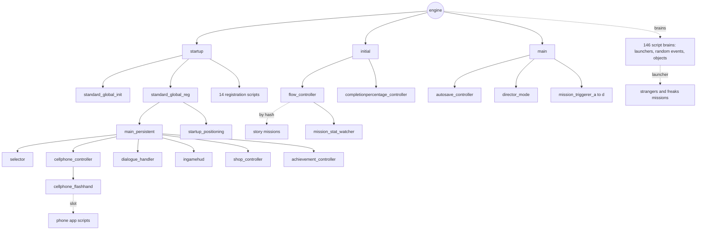
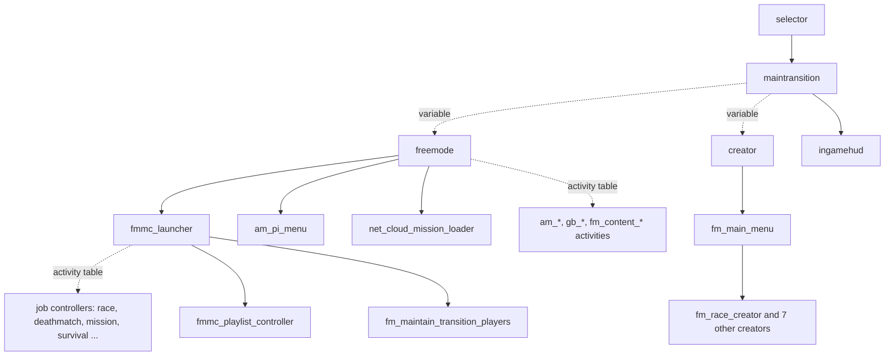

# Script launch graph (build 3725)

Every script launch in the build-3725 decompile whose script name is written in the call: which script starts which, with the stack size passed. 679 edges from 283 calling scripts to 230 started scripts. Generated by `tools/script-launch-graph.ps1` (read-only, under a minute); explained in [engine guide 1](/docs/core/runtime-scripts.md#17-the-launch-graph-first-pass-r05), which also lists what this first pass misses (launches by variable or lookup table, script brains, engine starts). Stack pool names are in [section 1.4](/docs/core/runtime-scripts.md#14-script-stack-pools) of that guide.

## What the table doesn't show

The table lists only calls whose script name is written in the call. Three other ways scripts start, all documented elsewhere (**Verified** in those guides):

| Way | How many | Where it's described |
| --- | ---: | --- |
| **Started by the engine** | `startup` at boot; `main` and `initial` for a story game (no script starts them) | [runtime scripts](/docs/core/runtime-scripts.md) |
| **Script brains** registered by `standard_global_init` and started by the engine when the player comes near | 99 world-point brains (31 `launcher_*`, 35 `re_*` random events, 14 `gpb_*` street characters, secrets, beds and sofas) and 47 object brains (ATMs, TVs, vending machines, darts ...) | [strangers, freaks and side content](/docs/gameplay/missions/strangers-and-freaks.md) |
| **Names taken from a table or variable** | `maintransition` starts `freemode` (35,250) or `creator` (28,000); `fm_main_menu` picks one of 8 creator scripts; `fmmc_launcher` and 265 other scripts share a 270-entry activity table; `cellphone_flashhand` starts the app in a phone slot; `flow_controller` starts story missions by hash. The second pass resolved most of these: [launches by variable and by table](#launches-by-variable-and-by-table-second-pass) | [transitions](/docs/online/transitions-and-sessions.md), [creator internals](/docs/online/creator-internals.md), [job lobby](/docs/online/job-lobby.md), [phone and apps](/docs/online/interaction-menu-phone-apps.md), [story flow](/docs/gameplay/missions/story-flow.md) |

## Launches by variable and by table (second pass)

Read in the build-3725 decompile (commit `6c18d3e8b`) on 2026-10-30 with a throwaway script (not in the repo). **Verified** unless marked.

**Counted:** **502 launch calls in 263 scripts** pass the script name as something other than a literal (`START_NEW_SCRIPT` 259, `START_NEW_SCRIPT_WITH_ARGS` 206, the two hash versions 37).

**Followed back, 220 calls:** the name was traced through the function's parameters to every caller in the same script, through locals, through functions that return a name, and through `GET_HASH_KEY`. Most are shared helpers ("start this script if it isn't running") that each script calls with literal names. They reach **391 distinct scripts, 306 of them missing from the generated table below**: nearly all of the `am_*` free-mode events and services (`am_airstrike`, `am_hold_up`, `am_crate_drop`, `am_gang_call` ...), most `fm_content_*` and `gb_*` activities, and the story helpers started through wrappers.

**Read from a table, the rest.** Six tables cover most of them:

| Table | Filled by | Read by | Scripts it names |
| --- | --- | --- | --- |
| The phone's app slots (`Global_9470`, 15 values a slot; the script name at value 5) | `cellphone_controller`, one registration call per slot | the phone code in 55 scripts (110 calls) | 17 app scripts: `appContacts`, `appInternet`, `appEmail`, `appMPEmail`, `appTextMessage`, `appCamera`, `appSettings`, `appChecklist`, `appTrackify`, `appMPJobListNEW`, `appMPCopBackup`, `AppJIPMP`, `appMPBossAgency`, `appHackerDen`, `appExtraction`, `appSecuroHack`, `appVLSI` |
| The strangers-and-freaks table (63 entries, shared code) | the entry function of the shared code | each `launcher_*` brain (starts the entry's mission, `Abigail1` ... `Tonya5`) and the pass code in 64 scripts | the 63 missions, plus **16 follow-up scripts** started when a mission passes: `Abigail1` starts `ambient_Diving`, `Barry4` `postRC_Barry4`, `Epsilon3` `epsCars`, `Epsilon4` `postRC_Epsilon4`, `Epsilon5` `epsRobes`, `Epsilon7` `epsDesert`, `Epsilon8` `epsilonTract`, `Hao1` `controller_Races`, `Josh1` `forSaleSigns`, `Maude1` `BailBond_Launcher`, `MrsPhilips1` `ambient_MrsPhilips`, `Nigel3` `postRC_Nigel3`, `Omega1` `spaceshipParts`, `Rampage2` `rampage_controller`, `Tonya1` `ambient_TonyaCall`, `Tonya2` `ambient_Tonya` |
| The story mission table (`Global_93192`, 94 entries) | `standard_global_init` | `flow_controller`, `mission_repeat_controller` | 92 mission scripts ([story flow](/docs/gameplay/missions/story-flow.md)) |
| Each activity launcher's own name | the launcher at start | the launcher brain | `golf`, `Darts`, `range_modern`, `TriathlonSP`, `Yoga`, `Pilot_School`, `Offroad_Races`, `stunt_plane_races`, `bj` (both base-jump launchers), `hunting_ambient` |
| The family scenes | `main` (five house points) | `main` | `family_scene_m`, `_f0`, `_f1`, `_t0`, `_t1` (below) |
| `freemode`'s activity table, the property scripts' child-script tables (`am_mp_*`, 12 calls), `initial`'s table (`Global_96583`), `player_controller`'s switch scenes | | | **Not resolved yet** |

**The family scenes** (`main`, **Verified**). `main` checks the five houses in turn: Michael's house (-812.1, 179.5), Franklin's aunt's house (-14.3, -1,436.0), Franklin's hills house (-1.3, 531.6), Trevor's trailer (1,974.6, 3,819.1) and Trevor's Vespucci flat (-1,152.6, -1,517.6). When the player is playing, no mission is set up, the matching script isn't running and the player is within **100 m** of the point, it starts `family_scene_m`, `_f0`, `_f1`, `_t0` or `_t1` with the point and a heading as arguments (stack 2,050). `family_scene_f0` is released again once the player is more than 50 m from its point.

**Scripts nothing starts.** Of the 1,145 scripts in the decompile, **296** are started by none of these paths (the generated table, the followed-back calls, the tables above, the 146 script brains, the engine starts). By family: 50 `am_mp_*` property and interior scripts and 13 `*_carmod` shops (started through the property tables not yet resolved), 16 Online phone apps (`appBunkerBusiness`, `appSmuggler`, `appMedia` ...; a second app table), 14 `player_scene_*` switch scenes, 12 `am_hs4_*` and airport travel cinematics, 6 `pausemenu*` scripts (*Known*: the pause menu starts these itself), 6 seating scripts, 12 activity scripts (`tennis`, `bigwheel`, `rollercoaster`, `bailbond1` to `4` ...) whose starter is another table, and **167 others, nearly all debug and test scripts** (`aicover_test`, `gtest_*`, `scripttest1` to `4`, `fps_test`, `net_*_soaktest`, `magdemo` ...) that ship in `script_rel.rpf` but nothing in the release game starts. `minigame_stats_tracker` and `minigame_ending_stinger` are in that last group (see [minigames](/docs/gameplay/missions/minigames-and-activities.md#425-scoring)).

## The backbone, story mode

## The backbone, Online

## The generated table

Regenerate after a game update: `powershell -NoProfile -ExecutionPolicy Bypass -File tools\script-launch-graph.ps1 -Out <scratch folder>` and copy `launch-graph.md` below this paragraph.

| Caller | Starts (stack) |
| --- | --- |
| `agency_heist1` | `buddydeathresponse (1424)`, `lesterhandler (1424)` |
| `agency_heist2` | `buddydeathresponse (1424)` |
| `agency_heist3a` | `buddydeathresponse (1424)` |
| `agency_heist3b` | `buddydeathresponse (1424)` |
| `agency_prep1` | `buddydeathresponse (1424)` |
| `am_mp_acid_lab` | `am_mp_peds (15900)` |
| `am_mp_arc_cab_manager` | `am_mp_drone (1424)`, `degenatron_games (8344)`, `ggsm_arcade (8344)`, `wizard_arcade (8344)` |
| `am_mp_arcade` | `am_mp_arc_cab_manager (8344)`, `am_mp_arcade_peds (5050)`, `am_mp_boardroom_seating (5050)`, `arcade_seating (5050)`, `gb_casino_heist_planning (64500)`, `ob_jukebox (1424)` |
| `am_mp_arcade_claw_crane` | `am_mp_drone (1424)`, `degenatron_games (8344)`, `ggsm_arcade (8344)`, `wizard_arcade (8344)` |
| `am_mp_arcade_love_meter` | `am_mp_drone (1424)`, `degenatron_games (8344)`, `ggsm_arcade (8344)`, `wizard_arcade (8344)` |
| `am_mp_arcade_strength_test` | `am_mp_drone (1424)`, `degenatron_games (8344)`, `ggsm_arcade (8344)`, `wizard_arcade (8344)` |
| `am_mp_arena_box` | `am_mp_drone (1424)`, `arena_box_bench_seats (1424)` |
| `am_mp_arena_garage` | `arena_workshop_seats (1424)` |
| `am_mp_armory_truck` | `appcovertops (1424)` |
| `am_mp_auto_shop` | `am_mp_arc_cab_manager (8344)`, `am_mp_boardroom_seating (5050)`, `am_mp_peds (15900)`, `am_mp_smoking_activity (1424)`, `auto_shop_seating (5050)`, `laptop_trigger (1424)` |
| `am_mp_bail_office` | `am_mp_peds (15900)`, `bail_office_seating (5050)` |
| `am_mp_bunker` | `am_mp_shooting_range (8344)` |
| `am_mp_business_hub` | `appbusinesshub (4592)`, `business_hub_garage_seats (1424)` |
| `am_mp_car_meet_property` | `am_mp_peds (15900)`, `appbikerbusiness (4592)`, `appimportexport (4592)`, `appinternet (4592)`, `appsecuroserv (4592)` |
| `am_mp_car_meet_sandbox` | `am_mp_peds (15900)` |
| `am_mp_casino` | `am_casino_peds (15900)`, `am_mp_smoking_activity (1424)`, `appbikerbusiness (4592)`, `appimportexport (4592)`, `appinternet (4592)`, `appsecuroserv (4592)`, `blackjack (5050)`, `casino_bar_seating (5050)`, `casino_lucky_wheel (5050)`, `casino_slots (5050)`, `casinoroulette (5050)`, `three_card_poker (5050)` |
| `am_mp_casino_apartment` | `am_mp_boardroom_seating (5050)`, `am_mp_smoking_activity (1424)`, `am_penthouse_peds (5050)`, `appbikerbusiness (4592)`, `appimportexport (4592)`, `appinternet (4592)`, `appsecuroserv (4592)`, `blackjack (5050)`, `casino_interior_seating (5050)`, `casino_main_lounge_seating (5050)`, `casino_penthouse_seating (5050)`, `ob_mp_shower_med (1424)`, `three_card_poker (5050)` |
| `am_mp_casino_nightclub` | `am_mp_peds (15900)`, `am_mp_smoking_activity (1424)`, `casino_nightclub_seating (5050)` |
| `am_mp_defunct_base` | `base_corridor_seats (1424)`, `base_entrance_seats (1424)`, `base_heist_seats (1424)`, `base_lounge_seats (5050)`, `base_quaters_seats (1424)`, `base_reception_seats (1424)`, `gb_gang_ops_planning (64500)` |
| `am_mp_drone` | `cellphone_flashhand (1424)` |
| `am_mp_field_hangar` | `field_hangar_seating (5050)` |
| `am_mp_fixer_hq` | `am_mp_arc_cab_manager (8344)`, `am_mp_boardroom_seating (5050)`, `am_mp_peds (15900)`, `am_mp_smoking_activity (1424)`, `appbikerbusiness (4592)`, `appimportexport (4592)`, `appinternet (4592)`, `appsecuroserv (4592)`, `fixer_hq_seating (5050)`, `fixer_hq_seating_op_floor (5050)`, `fixer_hq_seating_pq (5050)`, `ob_mp_shower_med (1424)` |
| `am_mp_hacker_den` | `am_mp_peds (15900)`, `am_mp_smoking_activity (1424)`, `am_simosa (1828)`, `hacker_den_carmod (3750)`, `hacker_den_seating (5050)` |
| `am_mp_hacker_truck` | `am_mp_drone (1424)`, `am_mp_vehicle_weapon (1424)`, `apphackertruck (4592)` |
| `am_mp_hangar` | `am_mp_peds (15900)` |
| `am_mp_island` | `am_mp_peds (15900)`, `beach_exterior_seating (5050)` |
| `am_mp_juggalo_hideout` | `am_mp_arc_cab_manager (8344)`, `am_mp_peds (15900)`, `am_mp_smoking_activity (1424)`, `juggalo_hideout_seating (5050)`, `ob_jukebox (1424)` |
| `am_mp_mansion` | `am_mp_arc_cab_manager (8344)`, `am_mp_boardroom_seating (5050)`, `am_mp_peds (15900)`, `mansion_club_bar (1424)`, `mansion_lobby_seating (5050)`, `net_mansion_yoga (1828)`, `ob_mp_shower_med (1424)`, `si_dancing_activity (8344)` |
| `am_mp_multistorey_garage` | `multistorey_garage_seating (5050)` |
| `am_mp_music_studio` | `am_mp_arc_cab_manager (8344)`, `am_mp_peds (15900)`, `music_studio_seating (5050)`, `music_studio_smoking (1424)` |
| `am_mp_nightclub` | `am_mp_peds (15900)`, `nightclub_ground_floor_seats (1424)`, `nightclub_office_seats (1424)`, `nightclub_vip_seats (1424)`, `nightclubpeds (15900)` |
| `am_mp_property_int` | `am_mp_peds (15900)`, `appbikerbusiness (4592)`, `appimportexport (4592)`, `appinternet (4592)`, `appsecuroserv (4592)`, `carmod_shop (3750)`, `ob_jukebox (1424)`, `ob_mp_shower_med (1424)`, `stripclub_drinking (2050)` |
| `am_mp_salvage_yard` | `am_mp_peds (15900)`, `am_mp_smoking_activity (1424)`, `salvage_yard_seating (5050)` |
| `am_mp_sb_car_wash` | `am_mp_peds (15900)` |
| `am_mp_sb_heli_tours` | `am_mp_peds (15900)`, `sb_heli_tours_seating (5050)` |
| `am_mp_sb_weed_shop` | `am_mp_peds (15900)`, `am_mp_smoking_activity (1424)`, `sb_weed_shop_seating (5050)` |
| `am_mp_simeon_showroom` | `appbikerbusiness (4592)`, `appimportexport (4592)`, `appinternet (4592)`, `appsecuroserv (4592)`, `simeon_showroom_seating (5050)` |
| `am_mp_smpl_interior_ext` | `am_mp_rpa_menu (1424)`, `am_mp_smpl_interior_int (2512)` |
| `am_mp_submarine` | `am_mp_boardroom_seating (5050)`, `am_mp_drone (1424)`, `am_mp_peds (15900)` |
| `am_mp_warehouse` | `am_mp_peds (15900)` |
| `am_pi_menu` | `appbikerbusiness (4592)`, `appimportexport (4592)`, `appinternet (4592)`, `appsecuroserv (4592)` |
| `am_prostitute` | `pb_prostitute (2050)` |
| `am_vehicle_spawn` | `luxe_veh_activity (1424)` |
| `ambient_mrsphilips` | `mission_stat_watcher (1828)` |
| `ambient_sonar` | `cellphone_flashhand (1424)` |
| `ambient_tonya` | `mission_stat_watcher (1828)` |
| `appemail` | `appbikerbusiness (4592)`, `appimportexport (4592)`, `appinternet (4592)`, `appsecuroserv (4592)` |
| `appmpemail` | `appcontacts (4000)` |
| `apptextmessage` | `appcontacts (4000)` |
| `armenian1` | `buddydeathresponse (1424)` |
| `armenian2` | `buddydeathresponse (1424)` |
| `armenian3` | `buddydeathresponse (1424)` |
| `assassin_bus` | `buddydeathresponse (1424)` |
| `assassin_construction` | `buddydeathresponse (1424)` |
| `assassin_hooker` | `buddydeathresponse (1424)` |
| `assassin_multi` | `buddydeathresponse (1424)` |
| `assassin_valet` | `buddydeathresponse (1424)` |
| `barry1` | `postrc_barry1and2 (1424)` |
| `barry2` | `postrc_barry1and2 (1424)` |
| `bootycallhandler` | `stripperhome (1424)` |
| `camhedz_arcade` | `am_mp_drone (1424)`, `degenatron_games (8344)`, `ggsm_arcade (8344)`, `wizard_arcade (8344)` |
| `carsteal1` | `buddydeathresponse (1424)` |
| `carsteal2` | `buddydeathresponse (1424)` |
| `carsteal3` | `buddydeathresponse (1424)` |
| `carsteal4` | `buddydeathresponse (1424)` |
| `cellphone_controller` | `cellphone_flashhand (1424)` |
| `cellphone_flashhand` | `cellphone_flashhand (1424)` |
| `chinese1` | `buddydeathresponse (1424)` |
| `chinese2` | `buddydeathresponse (1424)` |
| `context_controller` | `appbikerbusiness (4592)`, `appimportexport (4592)`, `appinternet (4592)`, `appsecuroserv (4592)` |
| `controller_towing` | `towing (64500)` |
| `controller_trafficking` | `traffick_air (64500)`, `traffick_ground (64500)` |
| `country_race_controller` | `country_race (5050)` |
| `creator` | `fm_main_menu (5050)`, `ugc_global_registration (128)`, `ugc_global_registration_2 (128)` |
| `darts` | `buddydeathresponse (1424)` |
| `degenatron_games` | `am_mp_drone (1424)`, `degenatron_games (8344)`, `ggsm_arcade (8344)`, `wizard_arcade (8344)` |
| `director_mode` | `autosave_controller (1424)` |
| `docks_heista` | `buddydeathresponse (1424)`, `docks2asubhandler (1424)` |
| `docks_heistb` | `buddydeathresponse (1424)`, `cellphone_flashhand (1424)` |
| `docks_prep1` | `buddydeathresponse (1424)` |
| `docks_prep2b` | `buddydeathresponse (1424)` |
| `docks_setup` | `buddydeathresponse (1424)` |
| `drf1` | `buddydeathresponse (1424)` |
| `drf2` | `buddydeathresponse (1424)` |
| `drf3` | `buddydeathresponse (1424)` |
| `drf4` | `buddydeathresponse (1424)` |
| `drf5` | `buddydeathresponse (1424)` |
| `drunk_controller` | `drunk (1424)` |
| `emergencycalllauncher` | `emergencycall (512)` |
| `exile1` | `buddydeathresponse (1424)` |
| `exile2` | `buddydeathresponse (1424)` |
| `exile3` | `buddydeathresponse (1424)` |
| `family1` | `buddydeathresponse (1424)` |
| `family1taxi` | `taxiservice (1828)` |
| `family2` | `buddydeathresponse (1424)` |
| `family3` | `buddydeathresponse (1424)` |
| `family4` | `buddydeathresponse (1424)` |
| `family5` | `buddydeathresponse (1424)` |
| `family6` | `buddydeathresponse (1424)` |
| `fbi1` | `buddydeathresponse (1424)` |
| `fbi2` | `buddydeathresponse (1424)` |
| `fbi3` | `buddydeathresponse (1424)` |
| `fbi4` | `buddydeathresponse (1424)` |
| `fbi4_intro` | `buddydeathresponse (1424)` |
| `fbi4_prep1` | `buddydeathresponse (1424)` |
| `fbi4_prep2` | `buddydeathresponse (1424)` |
| `fbi4_prep3` | `buddydeathresponse (1424)` |
| `fbi4_prep4` | `buddydeathresponse (1424)` |
| `fbi4_prep5` | `buddydeathresponse (1424)` |
| `fbi5a` | `buddydeathresponse (1424)` |
| `finale_choice` | `cellphone_flashhand (1424)` |
| `finale_heist_prepa` | `buddydeathresponse (1424)` |
| `finale_heist_prepb` | `buddydeathresponse (1424)` |
| `finale_heist_prepc` | `buddydeathresponse (1424)` |
| `finale_heist_prepd` | `buddydeathresponse (1424)` |
| `finale_heist1` | `buddydeathresponse (1424)` |
| `finale_heist2a` | `buddydeathresponse (1424)` |
| `finale_heist2b` | `buddydeathresponse (1424)` |
| `finale_intro` | `buddydeathresponse (1424)` |
| `finalea` | `buddydeathresponse (1424)` |
| `finaleb` | `buddydeathresponse (1424)` |
| `finalec1` | `buddydeathresponse (1424)` |
| `finalec2` | `buddydeathresponse (1424)` |
| `flow_controller` | `mission_stat_watcher (1828)` |
| `fm_capture_creator` | `fm_mission_controller (89500)`, `ugc_global_registration (128)`, `ugc_global_registration_2 (128)` |
| `fm_content_acid_lab_sell` | `cellphone_flashhand (1424)` |
| `fm_content_acid_lab_setup` | `cellphone_flashhand (1424)` |
| `fm_content_acid_lab_source` | `cellphone_flashhand (1424)` |
| `fm_content_arms_trafficking` | `cellphone_flashhand (1424)` |
| `fm_content_bar_resupply` | `cellphone_flashhand (1424)` |
| `fm_content_bounty_targets` | `cellphone_flashhand (1424)` |
| `fm_content_business_battles` | `am_mp_drone (1424)`, `cellphone_flashhand (1424)` |
| `fm_content_car_wash_work` | `am_mp_drone (1424)`, `cellphone_flashhand (1424)` |
| `fm_content_cargo` | `cellphone_flashhand (1424)` |
| `fm_content_club_management` | `cellphone_flashhand (1424)` |
| `fm_content_clubhouse_contracts` | `cellphone_flashhand (1424)` |
| `fm_content_convoy` | `cellphone_flashhand (1424)` |
| `fm_content_daily_bounty` | `cellphone_flashhand (1424)` |
| `fm_content_dispatch_work` | `am_mp_drone (1424)`, `cellphone_flashhand (1424)` |
| `fm_content_drug_lab_work` | `cellphone_flashhand (1424)` |
| `fm_content_drug_vehicle` | `cellphone_flashhand (1424)` |
| `fm_content_export_cargo` | `cellphone_flashhand (1424)` |
| `fm_content_getaway_driver` | `cellphone_flashhand (1424)` |
| `fm_content_ghosthunt` | `cellphone_flashhand (1424)` |
| `fm_content_gunrunning` | `cellphone_flashhand (1424)` |
| `fm_content_hacker_cargo_finale` | `am_mp_drone (1424)` |
| `fm_content_hacker_house_finale` | `am_mp_drone (1424)`, `circuitblockhack (1424)` |
| `fm_content_hacker_house_prep` | `am_mp_drone (1424)`, `cellphone_flashhand (1424)` |
| `fm_content_hacker_whistle_fin` | `am_mp_drone (1424)`, `am_mp_rc_vehicle (1424)`, `word_hack (1424)` |
| `fm_content_hacker_whistle_prep` | `am_mp_drone (1424)`, `am_mp_rc_vehicle (1424)`, `cellphone_flashhand (1424)` |
| `fm_content_hacker_zancudo_fin` | `am_mp_drone (1424)`, `word_hack (1424)` |
| `fm_content_hacker_zancudo_prep` | `cellphone_flashhand (1424)` |
| `fm_content_helitours_tour` | `cellphone_flashhand (1424)` |
| `fm_content_island_dj` | `cellphone_flashhand (1424)` |
| `fm_content_island_heist` | `am_mp_drone (1424)`, `am_mp_island (15900)`, `cellphone_flashhand (1424)` |
| `fm_content_payphone_hit` | `cellphone_flashhand (1424)` |
| `fm_content_postal_worker` | `cellphone_flashhand (1424)` |
| `fm_content_security_contract` | `cellphone_flashhand (1424)` |
| `fm_content_sightseeing` | `cellphone_flashhand (1424)` |
| `fm_content_smuggler_ops` | `cellphone_flashhand (1424)` |
| `fm_content_smuggler_resupply` | `cellphone_flashhand (1424)` |
| `fm_content_smuggler_sell` | `cellphone_flashhand (1424)` |
| `fm_content_tow_truck_work` | `cellphone_flashhand (1424)` |
| `fm_content_tuner_robbery` | `cellphone_flashhand (1424)` |
| `fm_content_tycoon_odd_jobs` | `cellphone_flashhand (1424)` |
| `fm_content_valentine_cheater` | `cellphone_flashhand (1424)` |
| `fm_content_vehrob_arena` | `am_mp_drone (1424)` |
| `fm_content_vehrob_casino_prize` | `am_mp_drone (1424)` |
| `fm_content_vehrob_police` | `am_mp_drone (1424)`, `cellphone_flashhand (1424)` |
| `fm_content_vehrob_prep` | `am_mp_drone (1424)`, `cellphone_flashhand (1424)` |
| `fm_content_vehrob_submarine` | `cellphone_flashhand (1424)` |
| `fm_content_vehrob_task` | `cellphone_flashhand (1424)` |
| `fm_content_vip_contract_1` | `am_mp_drone (1424)`, `cellphone_flashhand (1424)` |
| `fm_content_weed_shop_delivery` | `cellphone_flashhand (1424)` |
| `fm_content_weed_shop_work` | `cellphone_flashhand (1424)` |
| `fm_deathmatch_controler` | `am_mp_rc_vehicle (1424)`, `spawn_activities (1424)` |
| `fm_deathmatch_creator` | `fm_deathmatch_controler (89500)`, `ugc_global_registration (128)`, `ugc_global_registration_2 (128)` |
| `fm_impromptu_dm_controler` | `spawn_activities (1424)` |
| `fm_lts_creator` | `fm_mission_controller (89500)`, `ugc_global_registration (128)`, `ugc_global_registration_2 (128)` |
| `fm_main_menu` | `basic_creator (64500)`, `fm_capture_creator (64500)`, `fm_deathmatch_creator (64500)`, `fm_lts_creator (64500)`, `fm_race_creator (64500)`, `fm_survival_creator (64500)`, `freemode_creator (64500)`, `public_mission_creator (64500)` |
| `fm_maintain_cloud_header_data` | `ugc_global_registration (128)`, `ugc_global_registration_2 (128)` |
| `fm_mission_controller` | `am_mp_orbital_cannon (1424)`, `am_mp_rc_vehicle (1424)`, `celebrations (5050)`, `cellphone_flashhand (1424)` |
| `fm_mission_controller_2020` | `am_mp_drone (1424)`, `am_mp_orbital_cannon (1424)`, `celebrations (5050)`, `cellphone_flashhand (1424)`, `circuitblockhack (1424)`, `localpopulator (1424)`, `mp_gameplay_menu (1424)`, `word_hack (1424)` |
| `fm_race_controler` | `am_mp_rc_vehicle (1424)` |
| `fm_race_creator` | `am_mp_island (15900)`, `ugc_global_registration (128)`, `ugc_global_registration_2 (128)` |
| `fm_survival_controller` | `mp_gameplay_menu (1424)` |
| `fm_survival_creator` | `fm_survival_controller (89500)`, `ugc_global_registration (128)`, `ugc_global_registration_2 (128)` |
| `fmmc_launcher` | `fm_impromptu_dm_controler (64500)`, `fm_maintain_transition_players (2050)`, `fmmc_playlist_controller (8344)`, `gb_casino_heist_planning (64500)`, `gb_gang_ops_planning (64500)`, `net_cloud_mission_loader (2050)` |
| `franklin0` | `buddydeathresponse (1424)` |
| `franklin1` | `buddydeathresponse (1424)` |
| `franklin2` | `buddydeathresponse (1424)` |
| `freemode` | `am_mp_arena_box (5050)`, `am_mp_drone (1424)`, `am_mp_island (15900)`, `am_mp_orbital_cannon (1424)`, `am_mp_rc_vehicle (1424)`, `am_mp_smpl_interior_ext (1424)`, `am_mp_smpl_interior_int (2512)`, `am_mp_yacht (5000)`, `am_penthouse_peds (5050)`, `am_pi_menu (9800)`, `appbikerbusiness (4592)`, `appimportexport (4592)`, `appinternet (4592)`, `appsecuroserv (4592)`, `cellphone_flashhand (1424)`, `emergencycalllauncher (1424)`, `fake_interiors (1424)`, `fm_maintain_cloud_header_data (1424)`, `fmmc_launcher (28000)`, `freemode_clearglobals (14100)`, `gb_biker_target_rival (512)`, `gb_ie_delivery_cutscene (2324)`, `heli_gun (5050)`, `missioniaaturret (15900)`, `net_cloud_mission_loader (2050)`, `sclub_front_bouncer (1424)`, `sctv (8344)`, `spawn_activities (1424)`, `vehicle_stealth_mode (1424)` |
| `gb_deathmatch` | `spawn_activities (1424)` |
| `gb_delivery` | `am_mp_island (15900)` |
| `ggsm_arcade` | `am_mp_drone (1424)`, `degenatron_games (8344)`, `ggsm_arcade (8344)`, `wizard_arcade (8344)` |
| `gunslinger_arcade` | `am_mp_drone (1424)`, `degenatron_games (8344)`, `ggsm_arcade (8344)`, `wizard_arcade (8344)` |
| `heist_ctrl_agency` | `lesterhandler (1424)` |
| `heist_ctrl_jewel` | `lesterhandler (1424)` |
| `ingamehud` | `ugc_global_registration (128)`, `ugc_global_registration_2 (128)` |
| `initial` | `af_intro_t_sandy (1424)`, `agency_prep2amb (2050)`, `ambient_solomon (1424)`, `ambientblimp (1424)`, `blip_controller (1424)`, `bootycallhandler (1424)`, `buildingsiteambience (128)`, `candidate_controller (1424)`, `cheat_controller (1424)`, `completionpercentage_controller (1424)`, `controller_ambientarea (1424)`, `controller_races (128)`, `controller_taxi (1424)`, `controller_trafficking (1424)`, `email_controller (1424)`, `emergencycalllauncher (1424)`, `event_controller (1424)`, `exile_city_denial (1424)`, `fbi4_prep3amb (2050)`, `finale_choice (1424)`, `finale_endgame (2050)`, `finale_heist_prepeamb (2050)`, `flow_controller (1424)`, `flowintrotitle (1424)`, `flowstartaccept (1424)`, `heist_ctrl_agency (2050)`, `heist_ctrl_docks (2050)`, `heist_ctrl_finale (2050)`, `heist_ctrl_jewel (2050)`, `heist_ctrl_rural (2050)`, `letterscraps (1424)`, `michael4leadout (1424)`, `mission_stat_alerter (1424)`, `mpstatsinit (1424)`, `pickup_controller (1424)`, `pickupvehicles (128)`, `player_controller (1424)`, `randomchar_controller (1424)`, `restrictedareas (1424)`, `sh_intro_f_hills (1424)`, `sh_intro_m_home (1424)`, `stock_controller (1424)`, `taxilauncher (1424)`, `vehicle_gen_controller (1828)` |
| `jewelry_heist` | `buddydeathresponse (1424)`, `controller_ambientarea (1424)` |
| `jewelry_prep1a` | `buddydeathresponse (1424)` |
| `jewelry_prep1b` | `buddydeathresponse (1424)` |
| `jewelry_prep2a` | `buddydeathresponse (1424)` |
| `jewelry_setup1` | `buddydeathresponse (1424)` |
| `lamar1` | `buddydeathresponse (1424)` |
| `laptop_trigger` | `appbikerbusiness (4592)`, `appimportexport (4592)`, `appinternet (4592)`, `appsecuroserv (4592)` |
| `launcher_abigail` | `mission_stat_watcher (1828)` |
| `launcher_barry` | `mission_stat_watcher (1828)` |
| `launcher_dreyfuss` | `mission_stat_watcher (1828)` |
| `launcher_epsilon` | `mission_stat_watcher (1828)` |
| `launcher_extreme` | `mission_stat_watcher (1828)` |
| `launcher_fanatic` | `mission_stat_watcher (1828)` |
| `launcher_hao` | `mission_stat_watcher (1828)` |
| `launcher_hunting` | `mission_stat_watcher (1828)` |
| `launcher_josh` | `mission_stat_watcher (1828)` |
| `launcher_maude` | `mission_stat_watcher (1828)` |
| `launcher_minute` | `mission_stat_watcher (1828)` |
| `launcher_mrsphilips` | `mission_stat_watcher (1828)` |
| `launcher_nigel` | `mission_stat_watcher (1828)` |
| `launcher_omega` | `mission_stat_watcher (1828)` |
| `launcher_paparazzo` | `mission_stat_watcher (1828)` |
| `launcher_racing` | `mission_race (64500)` |
| `launcher_rampage` | `mission_stat_watcher (1828)` |
| `launcher_tennis` | `tennis_ambient (5050)`, `tennis_family (5050)` |
| `launcher_thelastone` | `mission_stat_watcher (1828)` |
| `launcher_tonya` | `mission_stat_watcher (1828)` |
| `lester1` | `buddydeathresponse (1424)` |
| `luxe_veh_activity` | `appbikerbusiness (4592)`, `appimportexport (4592)`, `appinternet (4592)`, `appsecuroserv (4592)` |
| `main` | `ambient_solomon (1424)`, `ambient_sonar (1424)`, `ambient_ufos (1424)`, `ambientblimp (1424)`, `animal_controller (5050)`, `autosave_controller (1424)`, `bootycallhandler (1424)`, `cablecar (1424)`, `code_controller (1424)`, `comms_controller (1424)`, `controller_races (1424)`, `controller_towing (1424)`, `country_race_controller (1424)`, `director_mode (64500)`, `flow_help (128)`, `friends_controller (2050)`, `mission_repeat_controller (2050)`, `mission_triggerer_a (5050)`, `mission_triggerer_b (5050)`, `mission_triggerer_c (5050)`, `mission_triggerer_d (5050)`, `net_cloud_mission_loader (2050)`, `photographymonkey (2050)`, `photographywildlife (1424)`, `pi_menu (5050)`, `player_controller_b (5050)`, `randomchar_controller (1424)`, `replay_controller (1424)`, `respawn_controller (1424)`, `save_anywhere (1424)`, `wardrobe_sp (2324)` |
| `main_persistent` | `achievement_controller (1424)`, `building_controller (1424)`, `cellphone_controller (1424)`, `context_controller (1424)`, `dialogue_handler (1424)`, `drunk_controller (1424)`, `error_listener (1424)`, `ingamehud (5050)`, `selector (1424)`, `shop_controller (3800)`, `social_controller (1828)`, `stats_controller (1424)`, `ugc_global_registration (128)`, `ugc_global_registration_2 (128)` |
| `maintransition` | `fm_maintain_cloud_header_data (1424)`, `ingamehud (5050)`, `spawn_activities (1424)`, `ugc_global_registration (128)`, `ugc_global_registration_2 (128)` |
| `martin1` | `buddydeathresponse (1424)` |
| `me_amanda1` | `buddydeathresponse (1424)` |
| `me_jimmy1` | `buddydeathresponse (1424)` |
| `me_tracey1` | `buddydeathresponse (1424)` |
| `michael1` | `buddydeathresponse (1424)` |
| `michael2` | `buddydeathresponse (1424)`, `cellphone_flashhand (1424)` |
| `michael3` | `buddydeathresponse (1424)` |
| `michael4` | `buddydeathresponse (1424)` |
| `mission_repeat_controller` | `ambient_tonya (1424)`, `buildingsiteambience (128)`, `controller_taxi (1424)`, `mission_stat_watcher (1828)` |
| `net_apartment_activity` | `appbikerbusiness (4592)`, `appimportexport (4592)`, `appinternet (4592)`, `appsecuroserv (4592)` |
| `net_apartment_activity_light` | `appbikerbusiness (4592)`, `appimportexport (4592)`, `appinternet (4592)`, `appsecuroserv (4592)` |
| `placeholdermission` | `buddydeathresponse (1424)` |
| `prologue1` | `buddydeathresponse (1424)` |
| `public_mission_controller` | `am_mp_drone (1424)`, `am_mp_orbital_cannon (1424)`, `celebrations (5050)`, `cellphone_flashhand (1424)`, `circuitblockhack (1424)`, `localpopulator (1424)`, `mp_gameplay_menu (1424)`, `spawn_activities (1424)`, `word_hack (1424)` |
| `public_mission_creator` | `ugc_global_registration (128)`, `ugc_global_registration_2 (128)` |
| `puzzle` | `am_mp_drone (1424)`, `degenatron_games (8344)`, `ggsm_arcade (8344)`, `wizard_arcade (8344)` |
| `replay_controller` | `mission_stat_watcher (1828)` |
| `road_arcade` | `am_mp_drone (1424)`, `degenatron_games (8344)`, `ggsm_arcade (8344)`, `wizard_arcade (8344)` |
| `rural_bank_heist` | `buddydeathresponse (1424)` |
| `rural_bank_prep1` | `buddydeathresponse (1424)` |
| `rural_bank_setup` | `buddydeathresponse (1424)` |
| `selector` | `maintransition (8032)` |
| `shop_controller` | `am_arena_shp (512)`, `wardrobe_mp (2324)` |
| `social_controller` | `tuneables_processing (1424)` |
| `solomon1` | `buddydeathresponse (1424)` |
| `solomon2` | `buddydeathresponse (1424)` |
| `solomon3` | `buddydeathresponse (1424)` |
| `spawn_activities` | `spawn_activities (1424)` |
| `standard_global_reg` | `main_persistent (1424)`, `startup_positioning (2324)` |
| `startup` | `standard_global_init (1424)`, `standard_global_reg (1424)` |
| `startup_install` | `main_install (1424)` |
| `stripclub` | `sclub_front_bouncer (1424)`, `stripperhome (1424)` |
| `stripclub_mp` | `stripperhome (1424)` |
| `taxilauncher` | `taxiservice (1828)` |
| `tennis` | `buddydeathresponse (1424)` |
| `tennis_ambient` | `buddydeathresponse (1424)` |
| `tennis_family` | `buddydeathresponse (1424)` |
| `tennis_network_mp` | `buddydeathresponse (1424)` |
| `tonya2` | `ambient_tonyacall2 (1424)` |
| `tonya5` | `ambient_tonyacall5 (1424)` |
| `trevor1` | `buddydeathresponse (1424)` |
| `trevor2` | `buddydeathresponse (1424)` |
| `trevor3` | `buddydeathresponse (1424)` |
| `trevor4` | `buddydeathresponse (1424)` |
| `turret_cam_script` | `am_mp_drone (1424)` |
| `wizard_arcade` | `am_mp_drone (1424)`, `degenatron_games (8344)`, `ggsm_arcade (8344)`, `wizard_arcade (8344)` |

